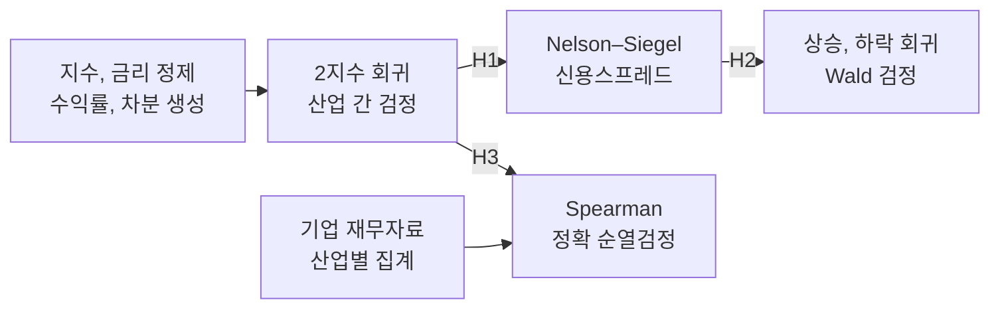
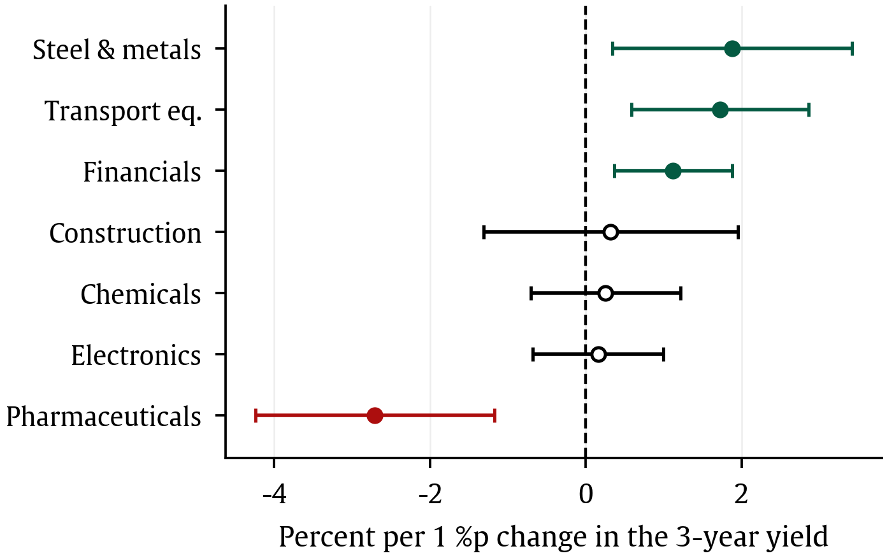
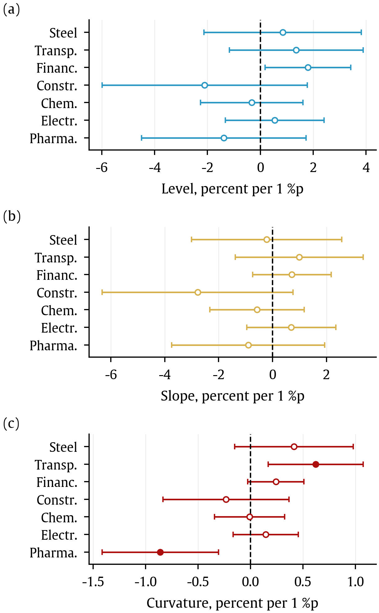
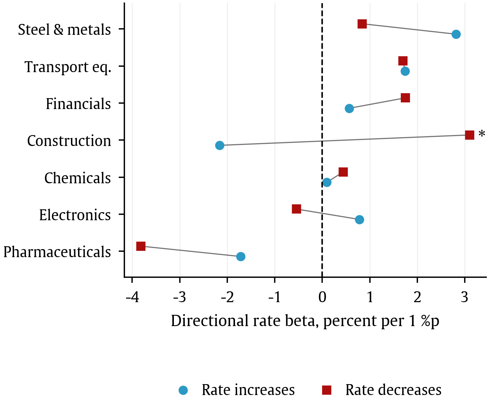

# Industry Interest-Rate Exposure

## Overview

2016–2025년 한국 **7개 산업지수**의 금리 민감도 분석. KOSPI 수익률을 통제한 뒤 산업별 차이를 추정하고, 수익률곡선 요인, 금리 방향, 산업 재무특성과의 관계를 살펴봄.

     

## Data

| Item | Scope |
|---|---|
| 기간 | 2016-01-04–2025-12-30 |
| 회귀 표본 | 산업별 2,451 거래일, 총 17,157 산업-일 관측치 |
| 산업 | 건설업, 금융업, 운수장비, 의약품, 전기전자, 철강금속, 화학 |
| 주가지수 | KRX 산업지수, KOSPI |
| 금리 | 한국은행 ECOS 국고채 1년, 3년, 5년, 10년 및 회사채 AA− 3년 |
| 기업 재무특성 | 산업별 시가총액 상위 10개사, 총 70개사의 2016–2025년 자료 |
| 기업자료 출처 | DART 재무제표, 배당, 사업보고서 및 KRX 구성종목, 시가총액 |

- **단위**: 일별 수익률은 소수, 금리 변화는 %p 단위의 1차 차분.
- **데이터**: 원자료와 가공 데이터는 저장소에 미포함. 입력 경로는 [Notebook 안내](notebooks/README.md#inputs) 참고.

## Research Design

1. **거래일을 맞추고 수익률과 금리 변화 생성**

   - 산업지수, KOSPI, 금리 자료를 날짜별로 병합하고 최초 차분 결측을 제외.

2. **시장수익률을 통제해 산업별 금리베타 추정**

   - 산업수익률을 KOSPI 수익률과 국고채 3년물 금리 변화에 회귀하는 **2지수 모형** 사용.
   - 산업별 계수에는 HAC(Newey–West, 시차 5) 표준오차, 산업 간 공동검정과 쌍별 비교에는 날짜 클러스터 표준오차 적용.
   - 여러 검정의 유의성은 검정족별 **BH(FDR) 보정**으로 판단.

3. **수익률곡선을 수준, 기울기, 곡률로 분해**

   - Nelson–Siegel 모형으로 만기별 금리를 세 요인으로 요약하고 산업별 노출 추정. 기본 λ=0.5.
   - 회사채와 국고채 3년물의 차이인 신용스프레드를 추가하고, 대체 λ와 곡률 측정 방식에 따른 결과 비교.

4. **금리 상승과 하락의 계수를 따로 추정**

   - 금리 변화를 상승분과 하락분으로 나누고 **Wald 검정**으로 두 계수의 동일성 판단.
   - 정책국면 상호작용을 추정하고 기간, 극단일 설정에 따른 결과 비교.

5. **금리베타와 산업 재무특성의 순위관계 분석**

   - 기업별 부채비율과 배당수익률을 산업별 시가총액가중 평균과 중앙값으로 집계.
   - **Spearman 순위상관과 정확 순열검정** 사용. 산업 수가 7개인 탐색적 분석으로 해석.

## Analysis Workflow



## Key Results

### Industry Differences

- **산업별 금리베타 동일성 기각**: 날짜 클러스터 공동검정 F=4.189, p=0.000338.
- BH 보정 후 유의한 **6개 산업 쌍 모두 의약품을 포함**. 나머지 15개 쌍에서는 차이가 확인되지 않음.

<p align="center">
  
</p>
<p align="center"><sub>논문 그림 1. 금리 1%p 변화당 수익률(%), Newey–West 시차 5의 95% 신뢰구간. 채워진 표식은 7개 산업 내 BH 5% 유의.</sub></p>

### Yield-Curve Factors

- 기본 **λ=0.5의 곡률**에서 산업 간 차이 관찰: F=3.580, BH p=0.0047. 의약품은 음(−), 운수장비는 양(+)의 계수.
- 수준과 기울기의 산업 간 차이는 BH 보정 후 비유의. 곡률 결과도 **대체 λ, 나비 곡률, 신용스프레드 추가 시 유지되지 않음**.

<p align="center">
  
</p>
<p align="center"><sub>논문 그림 4. 기본 λ=0.5, 요인 1%p 변화당 수익률(%)과 HAC 95% 신뢰구간. 채워진 표식은 요인별 7개 산업 내 BH 5% 유의. 요인 간 신뢰구간 폭의 직접 비교에 주의.</sub></p>

### Rate Increases and Decreases

- 국고채 3년물 상승, 하락 계수의 직접 비교에서 **건설업만 BH 5% 기준 충족**: BH p=0.0089.
- 상승분 계수는 음(−), 하락분 계수는 양(+). 하락분 자체가 음수이므로 두 방향 모두 수익률 하락과 연결되는 형태.
- 건설업 결과는 **2021년 이후에 집중**되며 극단일과 기간 설정에 민감함.

<p align="center">
  
</p>
<p align="center"><sub>논문 그림 5. 금리 1%p 변화당 수익률(%). 원은 상승분, 사각형은 하락분 계수. 별표는 두 계수의 동일성이 BH 5% 기준에서 기각된 산업.</sub></p>

### Financial Characteristics

- **배당수익률**은 시가총액가중 기준에서 양(+)의 순위상관 관찰. 중앙값 기준에서는 비유의.
- **부채비율**은 시가총액가중, 중앙값, 금융업 제외 기준 모두 비유의. 산업 수가 작고 집계 방식과 개별 산업의 영향이 큼.

| Characteristic | Aggregation | Spearman ρ | Exact p |
|---|---|---:|---:|
| 배당수익률 | 시가총액가중, n=7 | 0.8571 | 0.0238 |
| 배당수익률 | 중앙값, n=7 | 0.5357 | 0.2357 |
| 부채비율 | 시가총액가중, n=7 | 0.6071 | 0.1667 |

## Limitations

- **동시점 조건부 연관**에 대한 추정. 금리 변화에 경기, 물가 정보가 함께 포함되어 인과효과나 순수 통화정책 충격으로 해석할 수 없음.
- 산업 간 동일성 기각은 모든 산업 쌍의 차이를 뜻하지 않음. 곡률과 비대칭 결과는 사양과 기간에 따라 달라짐.
- 재무특성 분석은 산업 단위 n=7의 탐색 결과. 산업지수의 결과로 개별 기업의 반응이나 차이의 원인을 확정할 수 없음.

## Repository Structure

```text
├── notebooks/       # 통합 Notebook과 단계별 분석
├── src/             # 전처리, 회귀, 자료 수집 함수
├── results/         # 분석별 요약, 결과표, 그림
├── config.py        # 공통 경로와 분석 설정
├── pyproject.toml   # 패키지 설정
└── requirements.txt # 실행 의존성
```

[Notebook 및 입력 안내](notebooks/README.md), [분석 코드](src/README.md), [상세 결과](results/README.md)
