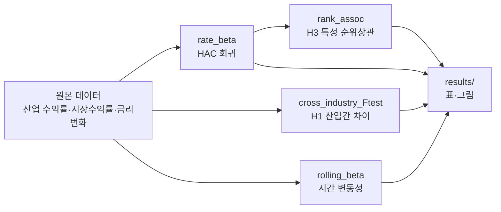

# Industry Rate Beta — 산업별 금리 베타 분석

FINDS Lab 학부연구인턴 3기 프로젝트. 2지수 모형(시장+금리)으로 산업별 금리 베타를 추정하고, 산업 간 차이와 시간 변동성을 검증한다.

<!-- 썸네일: 프로젝트 실행 후 GPT Image 2.0으로 생성해 이 자리에 추가 -->

`Status: In Progress` `Python 3.9+` `License: TBD`

## 1. 프로젝트 소개

- **What**: 산업 수익률을 시장수익률·금리변화 2개 요인에 회귀시켜 산업별 "금리 베타"를 HAC(Newey-West) 표준오차로 추정한다.
- **Why**: 금리 변화에 대한 민감도가 산업마다 다르다는 가설(H1)과, 그 차이가 산업 재무 특성과 관련 있다는 가설(H3)을 확인하기 위함.
- **핵심 기능 3줄**
  1. `rate_beta()` — 산업별 금리 베타·표준오차·p-value 추정
  2. `cross_industry_Ftest()` — 산업 간 금리 베타 동일성 F-검정 (H1)
  3. `rolling_beta()`, `rank_assoc()` — 시간 변동성 및 산업특성과의 순위상관 (H3)

## 2. 기술 스택

| 구분 | 도구 |
|---|---|
| 언어 | Python 3.9+ |
| 통계/회귀 | statsmodels (OLS, HAC 표준오차) |
| 데이터 처리 | pandas, numpy |
| 검정 | scipy.stats (spearmanr) |
| 협업 | Git/GitHub, Claude Code, Codex |

## 3. 실행 방법

```bash
git clone <repo-url>
cd Research_Intern
pip install -r requirements.txt
python src/models.py   # 합성 데이터로 파이프라인 동작 예시 실행
```

실제 데이터로 돌리려면 `data/`에 원본 데이터를 두고(비공개, 아래 4번 참고), `rate_beta()` / `cross_industry_Ftest()`에 실제 수익률·금리 시계열을 넣어 호출한다.

## 4. 아키텍처



> 추후 GPT Image 2.0으로 위 다이어그램을 이미지화해 대체 예정.

## 5. 주요 결과 / 성과 지표

_아직 실데이터 분석 전. 결과가 나오면 추정 계수·F-검정 p-value·순위상관 표를 이 섹션에 채운다._

## 6. 디렉토리 구조

구조 원칙: **인프라(`data/`, `src/`)와 공통 파이프라인(`notebooks/`)은 가설과 무관하게 공유하고, 산출물(`results/`)만 가설(Baseline / H1 / H2 / H3)별로 나눈다.** 노트북은 전역 순번(`01_`, `02_`, ...)으로 이어지며, 번호는 분석 수행 순서를 의미할 뿐 가설 번호와 연결하지 않는다(예: `04_rate_beta_estimation.ipynb`가 Baseline 분석이어도 파일명은 바뀌지 않는다). STYLE_GUIDE의 STEP 표기도 파일명이 아니라 노트북 내부 제목에서만 쓴다.

연구 스토리라인은 **Baseline(산업별 금리민감도가 존재하는가) → H1(금리충격의 종류에 따라 다른가: Level·Slope·Curvature·Credit Spread, 모형 B) → H2(상승·하락·국면에 따라 다른가, 모형 C) → H3(기업 재무특성으로 설명되는가)** 순으로 이어지며, `results/`의 폴더 순서(알파벳순으로도 Baseline < H1 < H2 < H3)가 이 흐름과 그대로 일치한다.

```
Research_Intern/
├── README.md  CLAUDE.md  AGENTS.md  requirements.txt  .gitignore  config.py
├── .github/PULL_REQUEST_TEMPLATE.md
│
├── data/                     # 데이터 생명주기 (전부 git 추적 제외)
│   ├── README.md
│   ├── raw/                  # 원본 불변 (industry/ market/ firm/ rates/)
│   │   └── rates/            # treasury_yield_3y_10y(Baseline), treasury_yield_curve_1_3_5_10y·corporate_bond_aa_minus_3y(H1)
│   ├── interim/              # 중간 정제본 (industry_daily_clean, kospi_daily, yields_daily, yield_curve_daily)
│   └── processed/            # 분석용 최종 패널 (industry_rate_panel_daily, industry_rate_panel_extended)
│
├── src/                      # 재사용 라이브러리 (가설 무관)
│   ├── README.md  __init__.py
│   └── models.py             # rate_beta / cross_industry_Ftest / rolling_beta / rank_assoc
│                             #  (io.py·features.py·viz.py는 노트북 코드 추출 시 추가)
├── notebooks/                # 분석 서사, 전역 STEP 순번 (가설과 연결하지 않음)
│   ├── 01_data_preparation.ipynb      # STEP1: 정제·병합
│   ├── 02_variable_generation.ipynb   # STEP2: 파생변수 생성
│   ├── 03_eda_industry.ipynb          # STEP3: 기초통계·시계열·상관관계·검증
│   ├── 04_rate_beta_estimation.ipynb  # STEP4: Baseline 회귀·F검정
│   ├── 06_yield_curve_exposure.ipynb        # H1 / 모형 B: Level·Slope·Curvature·Credit Spread
│   └── 07_asymmetric_rate_response.ipynb    # H2 / 모형 C: 상승·하락 비대칭·Wald 검정
│
├── results/                  # ★ 가설 기준 고정 (figures/ · tables/ 분리)
│   ├── README.md
│   ├── EDA/{figures,tables}/  summary.md              # STEP1-3 공통 결과
│   ├── Baseline_industry_beta/{figures,tables}/ summary.md   # Baseline: 산업 간 금리베타 차이
│   ├── H1_yield_curve/{figures,tables}/ summary.md  06_summary_final.html   # H1: 금리충격 원천 분해 (모형 B)
│   ├── H2_asymmetry_regime/{figures,tables}/ summary.md       # H2: 비대칭·국면 (모형 C)
│   └── H3_firm_characteristics/{figures,tables}/              # H3: 기업 특성 (예정)
│
└── docs/
    ├── README.md  STYLE_GUIDE.md  NOTION_WORKSPACE.md
    ├── TEAM_ONBOARDING.html   CONFIG_USAGE_GUIDE.html   MODEL_C_HANDOFF.html
    ├── research_design/       # 확정된 연구 설계 (research_plan, research_gap_contribution)
    ├── meetings/              # 회의 기록, 날짜 중심 파일명 (YYYYMMDD_meeting.html)
    ├── feedback/              # 교수님 피드백 반영 계획
    ├── templates/             # STYLE_GUIDE 기반 템플릿
    └── private/               # 개인정보·비공개 자료 (git 추적 제외)
```

> H3 분석이 시작되면 `notebooks/`는 다음 순번(`08_...`)으로 이어 붙이고, 그 결과물은 `results/H3_firm_characteristics/`에 쌓는다. 새 가설(H4 등)이 생기면 `results/{Hn}_{설명}/` 패턴만 추가하면 된다.

### 파일명 규칙 (Naming Convention)

소문자 snake_case · ASCII 전용(한글·공백·쉼표 금지) · 날짜 프리픽스 금지(git이 이력 관리) · STEP 단어는 파일명에 쓰지 않는다(문서 내부 제목에서만 사용).

| 유형 | 규칙 | 예시 |
|---|---|---|
| notebook | `NN_stage.ipynb` (전역 순번) | `01_data_preparation.ipynb` |
| python | 모듈 명사 | `models.py`, `io.py` |
| processed csv | `{domain}_{grain}_{freq}.csv` | `industry_rate_panel_daily.csv` |
| figure | `{subject}_{type}.png` | `correlation_heatmap.png` |
| table | `{subject}[_by_{group}].csv` | `descriptive_statistics_by_industry.csv` |
| summary | `results/{카테고리}/summary.md` | `results/EDA/summary.md` |
| 리포트 html | `results/{카테고리}/NN_summary_final.html` (NN=notebook 번호) | `results/H1_yield_curve/06_summary_final.html` |
| 가이드 문서 | `docs/UPPER_SNAKE.html` | `docs/CONFIG_USAGE_GUIDE.html` |
| regression | `reg_{hyp}_{spec}.csv` | `reg_h1_rate_beta_hac.csv` |

## 7. 저장소 운영 방침 (Public / Private)

이 저장소는 **코드·분석 로직·README는 Public**으로 운영한다. 다만 다음은 Public 여부와 무관하게 저장소에 커밋하지 않는다.

- `docs/private/`: 교수님 피드백, 팀원 개인 일정이 담긴 프로젝트 계획서 등 개인정보·비공개 자료
- `data/`: 원본 금융 데이터. 재배포 라이선스 문제가 있을 수 있어 Private 여부와 무관하게 항상 제외

두 폴더 모두 `.gitignore`로 추적에서 제외했다. 로컬에는 그대로 남아있고, 협업자와는 별도 채널(Drive 등)로 공유한다.

## 8. 저장소 구조 설계 근거

이 프로젝트에는 직교하는 두 축이 있다 — **파이프라인 단계**(데이터준비→EDA→회귀→강건성)와 **연구 가설**(H1/H2/H3). STEP1-3(데이터 준비·변수 생성·EDA)은 가설과 무관한 공통 기반이라 `notebooks/`는 전역 순번으로 평면 관리하고, 가설별로 달라지는 것은 **산출물**이므로 `results/`만 카테고리(EDA 공통/H1/H3)별로 나누는 구조를 채택했다. 비교한 후보:

| 후보 | 설명 | 채택 |
|---|---|---|
| STEP 중심(전부 평면) | notebooks·results 모두 전역 단계 번호로 평면 관리 | ✗ 가설별 분석이 늘면 `results/`에서 어느 산출물이 어느 가설인지 파일명만으로 구분 안 됨 |
| H1/H2/H3 중심(전부) | data·src·notebooks까지 가설별 폴더로 분리 | ✗ STEP1-3은 H1·H2·H3가 공유하는 공통 기반이라 폴더마다 중복 |
| Pipeline 중심(results도 평면) | notebooks·results 둘 다 평면, 파일명에 가설 태그만 표시 | ✗ 가설별 산출물이 늘수록 평면 폴더가 뒤섞임 |
| **하이브리드(채택)** | notebooks는 전역 STEP 평면 + results만 카테고리별 분리 | ✓ 공통 단계는 순서대로, 가설별 산출물은 카테고리 폴더로 바로 찾을 수 있음 |

`data/`는 가설이 아니라 생명주기(`raw`→`interim`→`processed`)로 조직한다. 산업 원본은 H1·H2가 공유하고 기업 원본은 H3 전용이라, 가설별로 나누면 공유 데이터가 중복되기 때문이다.

## 9. 협업 가이드

혼자 진행하는 프로젝트라도 아래 흐름을 지킨다.

1. 작업 시작 전 로컬 `main`에 `git pull` (워크트리로 작업하는 에이전트는 자동으로 로컬 main에 반영되지 않을 수 있으니 반드시 확인)
2. 작업 단위로 브랜치 생성: `<type>/<짧은-설명>` 형식 (`feature/rate-beta-hac`, `fix/rolling-window`, `docs/readme-update`). `claude/~`, `codex/~` 같은 에이전트 자동 브랜치명은 사용하지 않는다.
3. 작업 후 `commit` → `push`
4. PR 생성: 무엇을 했는지 / 왜 했는지 / 팀원(교수님)이 확인해야 할 사항만 간단히 작성
5. 셀프 머지는 지양하고, 팀원·지도교수 확인 후 머지. 급한 경우가 아니면 "머지할게요" 안내 후 머지
6. 다른 작업이 먼저 반영됐을 수 있으니 항상 `pull` 받고 새 작업 시작

Claude Code/Codex로 작업할 때는 이 섹션을 그대로 따르도록 `CLAUDE.md`, `AGENTS.md`에 요약해 두었다.
