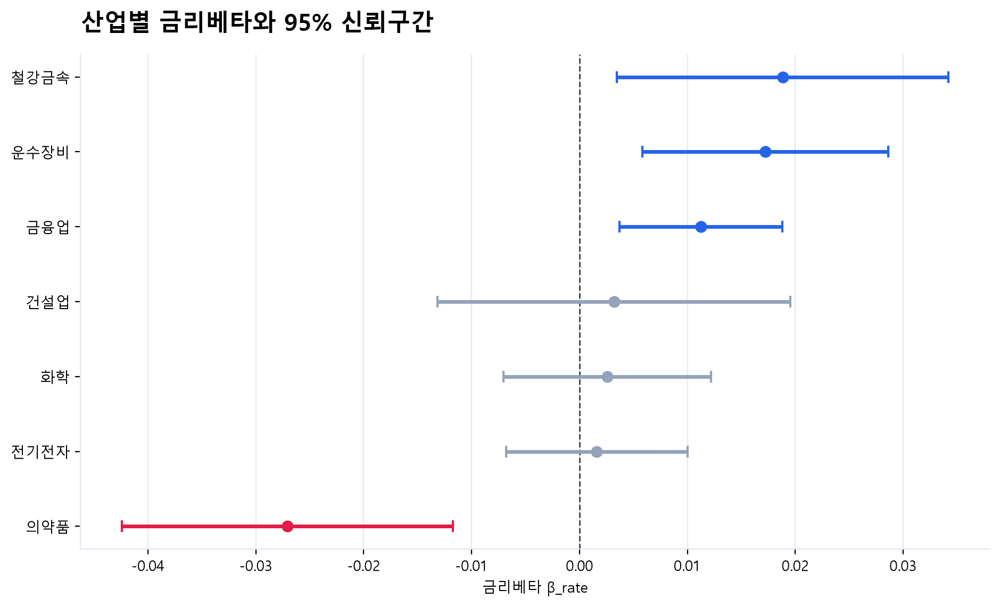

# 시장수익률을 통제한 산업별 금리노출의 이질성

2016–2025년 한국 7개 산업지수의 일별 자료로 산업별 금리 민감도를 추정한 FINDS Lab 학부 연구인턴 프로젝트다. 시장 전체의 움직임을 통제한 뒤에도 산업별 금리노출이 다른지, 그 차이가 어느 산업과 금리요인에서 관찰되는지 분석한다.

## 연구 질문

- 산업별 국고채 3년물 금리베타는 서로 다른가?
- 수익률곡선의 수준·기울기·곡률에 대한 노출은 산업별로 어떻게 다른가?
- 금리 상승과 하락에 대한 반응은 대칭적인가?
- 산업별 금리베타는 부채비율·배당수익률과 어떤 순위관계를 보이는가?

## 데이터

| 항목 | 내용 |
|---|---|
| 표본 기간 | 2016-01-04–2025-12-30 |
| 회귀 표본 | 산업별 2,451 거래일, 총 17,157 산업-일 관측치 |
| 산업 | 건설업, 금융업, 운수장비, 의약품, 전기전자, 철강금속, 화학 |
| 주가지수 | 한국거래소(KRX) 산업지수 및 KOSPI |
| 금리 | 한국은행 ECOS 국고채 1·3·5·10년, 회사채 AA− 3년 |
| 기업 재무특성 | 산업별 시가총액 상위 10개사, 총 70개사의 2016–2025년 자료 |
| 기업자료 출처 | DART 재무제표·배당·사업보고서, KRX 구성종목·시가총액 |

수익률은 소수 단위의 일별 변화율, 금리 변화는 %p 단위의 1차 차분이다. 최초 차분 결측을 제외한 표본으로 회귀를 추정한다. 원자료와 가공 데이터, 논문 원문은 저장소에 포함하지 않는다.

## 분석 방법

기본 모형은 산업수익률을 시장수익률과 국고채 3년물 금리 변화에 회귀하는 2지수 모형이다.

$$
R_{i,t}=\alpha_i+\gamma_i R_{M,t}+\beta_i\Delta y_{3,t}+\varepsilon_{i,t}
$$

$\beta_i$는 시장수익률을 통제한 산업별 금리노출이다. 산업별 추정에는 HAC(Newey–West, 시차 5) 표준오차를 사용한다. 산업 간 동일성은 산업별 절편·시장베타·금리베타를 허용하는 통합회귀에서 날짜 클러스터 공분산을 이용해 검정한다. 다중검정에는 검정족별 Benjamini–Hochberg FDR 보정을 적용한다.

확장 분석에서는 Nelson–Siegel 수익률곡선 요인(Level·Slope·Curvature, 기본 $\lambda=0.5$), 신용스프레드, 금리 상승·하락 분해와 정책국면을 살펴본다. 산업 재무특성과의 관계는 산업 단위 Spearman 순위상관과 정확 순열검정으로 평가한다.

## 주요 결과

**산업별 금리노출의 차이는 의약품과 다른 산업의 대비에 집중된다.** 날짜 클러스터 공동검정은 금리베타 동일성을 기각한다(F=4.189, p=0.000338). BH 보정 후 유의한 산업 쌍 6개는 모두 의약품을 포함하며, 나머지 15개 쌍에서는 차이가 확인되지 않는다.



**수익률곡선에서는 곡률 노출의 산업 간 차이가 관찰되지만 사양에 의존한다.** 기본 $\lambda=0.5$에서 곡률의 동일성 검정은 F=3.580, BH p=0.0047이다. 의약품은 음(−), 운수장비는 양(+)의 곡률 계수를 보인다. 수준·기울기 차이는 BH 보정 후 유의하지 않으며, 곡률 결과도 $\lambda$와 요인 구성에 민감하다.

**금리 상승·하락 반응의 차이는 건설업에서 확인된다.** 7개 산업별 Wald 검정에서 건설업만 BH 5% 기준을 충족한다(BH p=0.0089). 상승분 계수는 음(−), 하락분 계수는 양(+)이므로, 두 방향 모두 수익률 하락과 연결되는 형태다. 이 결과는 시기와 극단일 설정에 민감하다.

**재무특성과의 관계는 탐색적이다.** 배당수익률과 금리베타의 순위상관은 시가총액가중 기준에서 양(+)으로 관찰된다(ρ=0.8571, 정확 순열 p=0.0238). 중앙값 기준에서는 유의하지 않으며, 산업 수가 7개여서 집계 방식과 개별 산업의 영향이 크다.

| 분석 | 요약 | 핵심 결과표 |
|---|---|---|
| 산업별 금리베타 | [요약](results/Baseline_industry_beta/summary.md) | [산업 간 공동검정](results/Baseline_industry_beta/tables/industry_beta_joint_test.csv) |
| 수익률곡선 요인 | [요약](results/H1_yield_curve/summary.md) | [요인별 산업 간 차이](results/H1_yield_curve/tables/industry_difference_test.csv) |
| 상승·하락 비대칭 | [요약](results/H2_asymmetry_regime/summary.md) | [산업별 Wald 검정](results/H2_asymmetry_regime/tables/asymmetry_wald_tests.csv) |
| 산업 재무특성 | [요약](results/H3_firm_characteristics/summary.md) | [순위상관·순열검정](results/H3_firm_characteristics/tables/spearman_results.csv) |

## 해석의 범위

모든 추정치는 동시점 조건부 연관이다. 관측된 금리 변화에는 할인율·경기·물가 정보가 함께 포함되므로 인과효과나 순수한 통화정책 충격으로 해석하지 않는다. 산업 간 동일성 기각도 모든 산업 쌍이 서로 다르다는 뜻은 아니다.

수익률곡선 분해의 모수 의존성, 비대칭 결과의 기간·극단값 민감도, 재무특성 분석의 작은 횡단면 표본을 함께 고려해야 한다. 특히 산업지수의 결과만으로 개별 기업의 반응이나 산업별 차이의 기제를 확정할 수 없다.

## 저장소 구성

```text
├── notebooks/
│   ├── final.ipynb              # 전체 분석과 실행 결과
│   └── 01_... ~ 10_...          # 데이터 준비·단계별 분석
├── src/                        # 데이터 처리·추정·수집 함수
├── results/                    # 분석별 Markdown 요약·CSV 표·그림
├── config.py                   # 공통 경로·분석 설정
├── pyproject.toml
└── requirements.txt
```

## 실행

Python 3.9 이상 환경에서 실행한다.

```bash
git clone https://github.com/lcsvvo/FINDSLAB-Research-Intern.git
cd FINDSLAB-Research-Intern
pip install -e .
jupyter lab
```

데이터는 별도로 준비한 뒤 `01`→`10` 순서로 실행한다. 기업자료 수집에는 `OPENDART_API_KEY`·`KRX_API_KEY` 환경변수가 필요하다. 데이터 입력 형식은 각 노트북을 참고한다. 공개된 표·그림과 저장된 노트북 출력은 데이터 없이 열람할 수 있다.
