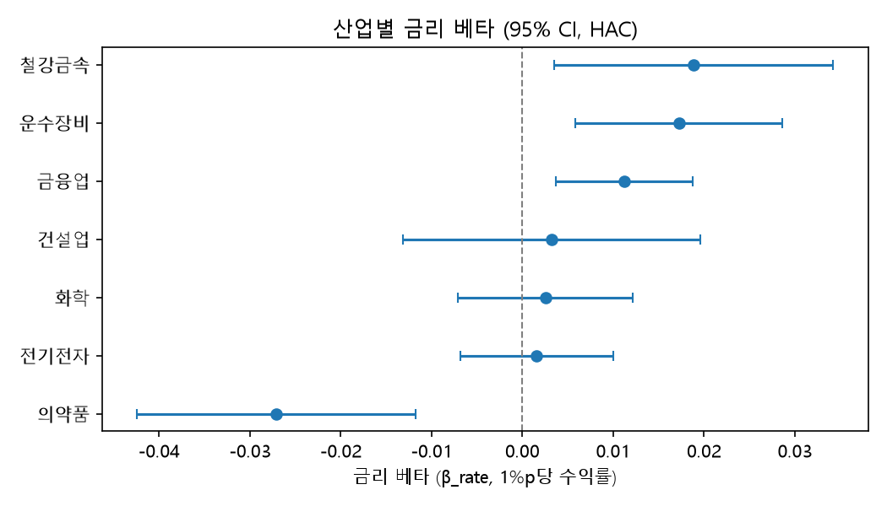

# STEP4. 산업별 금리 베타 추정 결과 요약

## Takeaway
- 국고채 3년 금리 상승 시 금융업·철강금속·운수장비는 유의한 양(+)의 베타, 의약품은 유의한 음(−)의 베타 확인됨.
- 전기전자·건설업·화학은 95% 신뢰구간이 0을 포함하여 비유의.
- BH 보정(α=0.05) 이후에도 4개 산업(금융업·철강금속·운수장비·의약품)의 유의성 유지.
- β_rate는 KOSPI 통제 후 조건부 금리 노출이며 인과관계를 의미하지 않음. 산업 간 차이는 STEP5 공동검정에서 확인했으며, 시기별 안정성은 별도 민감도 결과와 함께 해석함.

## 분석 개요
- 7개 산업(금융업·철강금속·운수장비·의약품·전기전자·건설업·화학) 대상 국고채 3년 금리 민감도를 2지수 모형으로 추정.
- 회귀식: industry_return = α + β_rate·d_y3 + γ·kospi_return + ε. KOSPI 수익률 통제 하에서 국고채 3년 금리 일별 변화분(d_y3, %p)에 대한 산업 수익률의 반응(β_rate) 추정.
- 표준오차는 HAC(Newey–West) 적용, 유의성 판정은 7개 산업 공동 BH(Benjamini–Hochberg) 보정 p값(α=0.05) 기준.
- 분석·재현·검증 절차는 `notebooks/04_rate_beta_estimation.ipynb`에 기록됨.

## 사용 데이터
- 입력 데이터: data/processed/industry_rate_panel_daily.csv 사용.
- 표본 기간 2016–2025 일별, 관측치 N=2,451.
- 변수 구성: 산업별 수익률(industry_return), 국고채 3년 금리 일별 변화분(d_y3, %p), KOSPI 수익률(kospi_return).
- 원자료 출처: 산업지수·KOSPI는 KRX, 국고채 3년 금리는 한국은행 ECOS. 병합·전처리는 STEP1~STEP2(src/data_prep.py) 기준.
- 추정 코드는 src/models.py에 구현됨.

## 핵심 결과

**표 1. 산업별 국고채 3년 금리 베타 추정 결과 (HAC 표준오차, BH 보정)**

| 산업 | 금리 베타(β) | 1%p당 수익률(%) | HAC SE | t | 원 p | BH p | 95% CI | R² | N |
|---|---|---|---|---|---|---|---|---|---|
| 금융업 | 0.01123 | +1.123 | 0.00385 | 2.91797 | 0.00352 | 0.00822 | [0.00369, 0.01878] | 0.62286 | 2451 |
| 철강금속 | 0.01884 | +1.884 | 0.00785 | 2.40088 | 0.01636 | 0.02862 | [0.00346, 0.03421] | 0.38342 | 2451 |
| 운수장비 | 0.01723 | +1.723 | 0.00581 | 2.96585 | 0.00302 | 0.00822 | [0.00584, 0.02862] | 0.47196 | 2451 |
| 의약품 | -0.02707 | -2.707 | 0.00783 | -3.45610 | 0.00055 | 0.00384 | [-0.04242, -0.01172] | 0.24326 | 2451 |
| 전기전자 | 0.00159 | +0.159 | 0.00429 | 0.36977 | 0.71155 | 0.71155 | [-0.00682, 0.01000] | 0.71928 | 2451 |
| 건설업 | 0.00320 | +0.320 | 0.00834 | 0.38421 | 0.70082 | 0.71155 | [-0.01314, 0.01955] | 0.39824 | 2451 |
| 화학 | 0.00256 | +0.256 | 0.00491 | 0.52072 | 0.60256 | 0.71155 | [-0.00707, 0.01219] | 0.64364 | 2451 |

> 이 표는 7개 산업의 국고채 3년 금리 베타와 유의성을 보여줌. BH 보정 후 의약품은 음(−), 금융업·철강금속·운수장비는 양(+), 전기전자·건설업·화학은 유의하지 않음.

'1%p당 수익률(%)' 열은 금리 1%p(100bp) 상승 기준으로 표준화한 선형 환산값이며, 실제 일별 금리 변동 규모와는 상이함.

**금융업**: 금리 베타 +0.01123, BH 보정 p값 0.00822로 유의. 95% 신뢰구간 [0.00369, 0.01878]로 전 구간 양(+)의 값 유지.

**철강금속**: 금리 베타 +0.01884, BH 보정 p값 0.02862로 유의. 95% 신뢰구간 [0.00346, 0.03421]로 전 구간 양(+)의 값 유지.

**운수장비**: 금리 베타 +0.01723, BH 보정 p값 0.00822로 유의. 95% 신뢰구간 [0.00584, 0.02862]로 전 구간 양(+)의 값 유지.

**의약품**: 금리 베타 −0.02707, BH 보정 p값 0.00384로 유의. 95% 신뢰구간 [−0.04242, −0.01172]로 전 구간 음(−)의 값 유지.

**전기전자**: 금리 베타 +0.00159, BH 보정 p값 0.71155로 비유의. 95% 신뢰구간 [−0.00682, 0.01000]로 0 포함.

**건설업**: 금리 베타 +0.00320, BH 보정 p값 0.71155로 비유의. 95% 신뢰구간 [−0.01314, 0.01955]로 0 포함.

**화학**: 금리 베타 +0.00256, BH 보정 p값 0.71155로 비유의. 95% 신뢰구간 [−0.00707, 0.01219]로 0 포함.

## 해석

**금융업**: 금리 상승에 따른 예대마진(NIM) 구조 개선 기대가 반영되었을 가능성이 있음. 다만 은행·보험·증권 등 하위업종별 반응 방향이 상이할 가능성이 있어, 하위업종 단위 분석 필요함.

**철강금속·운수장비**: 두 산업 모두 금리 상승 국면에서 경기 기대가 동반 반영되었을 가능성이 있음. 순수 금리효과와 경기 기대효과의 분리가 곤란하다는 해석상 유의점 공유. 철강금속은 전방수요 개선 기대가 반영되었을 가능성이 있음. 운수장비는 수출 및 설비투자 기대 개선이 반영되었을 가능성이 있음.

**의약품**: 장기 듀레이션 성장주로서의 특성상 할인율 상승 시 미래이익의 현재가치 하락과 정합적인 결과로 해석 가능[^1]. 다만 개별 기업의 R&D 비중 및 포트폴리오 구성 편차에 따른 해석상 유의 필요함.

**전기전자**: KOSPI 동조성이 지배적으로 작용하여 독립적인 금리 노출이 미검출되었을 가능성이 있음. 모형의 높은 설명력(R²=0.71928)은 금리 변수 단독이 아닌 KOSPI를 포함한 모형 전체의 설명력으로 해석 필요함.

**건설업**: 수주·PF(프로젝트파이낸싱) 등 산업 고유위험 비중이 상대적으로 큼. 단기 국채 금리 변화만으로는 PF·신용 스프레드 관련 위험이 포착되지 않았을 가능성이 있음.

**화학**: 전방산업 경기 동조 효과가 KOSPI 수익률에 선반영되었을 가능성이 있음. 장기 회사채 중심의 조달 구조로 인해 단기 국채 금리 변동에 따른 부담이 직접적으로 포착되지 않았을 가능성이 있음.

**해석상 유의점**: β_rate는 KOSPI 통제 후 조건부 금리 노출이며 인과관계를 의미하지 않음. 산업 간 베타 차이는 STEP5 공동검정에서 확인되었다. 표본 기간(2016–2025)은 코로나 충격·금리 인상기를 포함하며, HAC는 자기상관·이분산 보정에 한정되어 구조변화를 반영하지 않으므로 시기별 결과는 별도 rolling·기간 민감도와 함께 읽어야 함.

[^1]: PV = FV / (1+r)^n. 예시로 10년 후 100억 원의 현재가치는 할인율 5%일 때 약 61.4억 원, 6%일 때 약 55.8억 원 수준.
