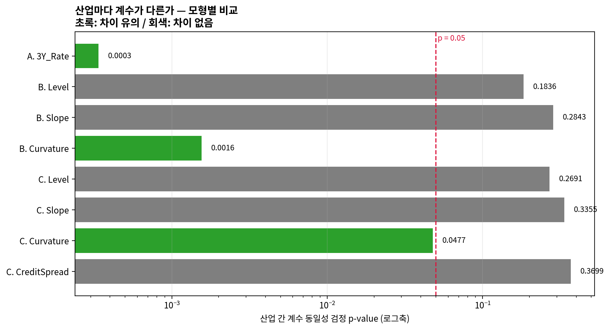
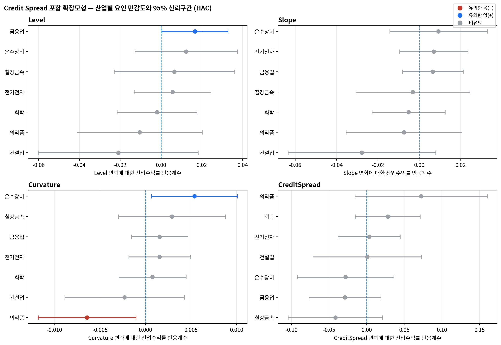
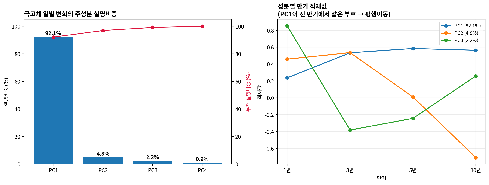
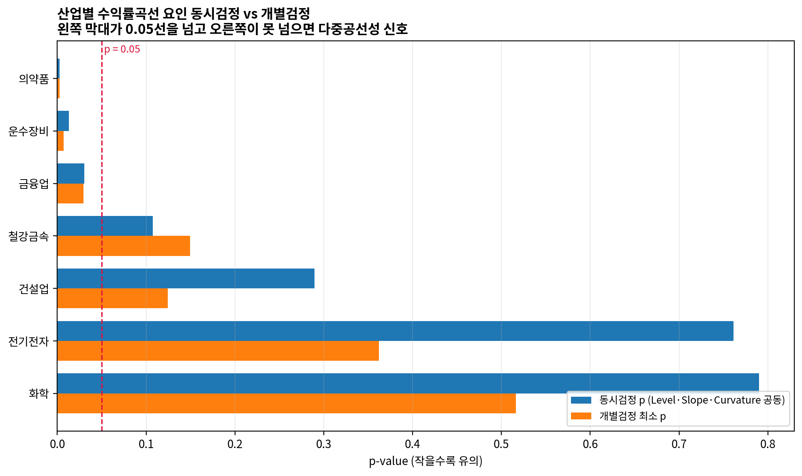
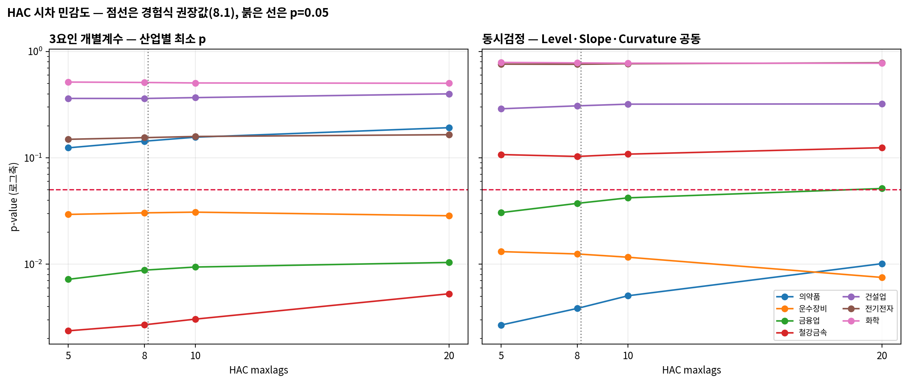
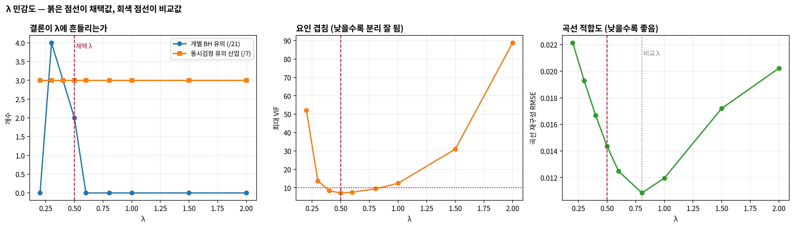

# STEP6. 수익률곡선 다요인 모형 분석 결과

**구성** B-1 금리요인 구축·핵심모형 · B-2 신용스프레드·검증·시각화
**노트북** `notebooks/06_yield_curve_exposure.ipynb`
**가설** H1 — 금리충격 원천에 따른 이질성

---

## Takeaway

- **곡률(Curvature) 노출은 산업마다 유의하게 다르다.** 산업 간 계수 동일성 검정에서 F=3.580, **BH p=0.0047**로 유의하다.
- **의약품은 −0.00860**(BH p=0.0165), **운수장비는 +0.00621**(BH p=0.0252)로 **방향이 반대**다. 곡선 중기 구간이 볼록해질 때 서로 다르게 움직인다.
- **Level·Slope는 어느 산업에서도 유의하지 않다.** 산업 간 차이 검정도 통과하지 못한다(BH p 0.275·0.284).
- **곡률 효과는 신용위험을 통제한 뒤에도 유지된다.** 4요인에서 계수가 줄어드는 것은 두 변수가 공유하는 18.6%의 배정 문제이며, 직교화하면 3요인 값으로 정확히 돌아온다(최대 차이 2.90e-06).
- **H1은 곡률 차원에서 지지된다.** 산업별 금리노출의 이질성은 금리 수준이 아니라 곡선의 중기 구간(약 3.6년)에서 나타난다.

---

## 이 문서 읽는 법

| 구분 | 내용 | 지위 |
|---|---|---|
| **1부** | 3요인·4요인 모형 추정과 검정 | 본분석 |
| **2부** | 자료 구조 진단과 강건성 점검 | 보조 |

> λ 기본값은 요인 분리 기준으로 정했다. 아래 "λ 선택" 절에 기준·근거·민감도를 밝혔다.

---

## 분석 개요

Baseline(STEP4·STEP5)에서 국고채 3년 기준 산업 간 금리베타 차이를 확인했다(BH p=0.00034).
이번 단계는 그 차이가 **곡선의 어느 부분에서 오는지**를 찾는 것이 목표다.

**회귀식**

```
산업수익률 = α + β_M·KOSPI
           + β_L·ΔLevel + β_S·ΔSlope + β_C·ΔCurvature
           + β_Credit·ΔCreditSpread + ε
```

| 항목 | 설정 |
|---|---|
| 요인 생성 | Nelson–Siegel, 공통 **λ = 0.5** (`config.NS_LAMBDA`) |
| Credit Spread | 회사채(3년, AA−) − 국고채 3년, 단위 %p |
| 표준오차 | HAC (Newey–West, maxlags=5) |
| 다중검정 | BH(FDR), 검정족 = 요인별 7개 산업 |
| 산업 간 차이 | 날짜 클러스터 표준오차 |
| 표본 | 2016-01-04 ~ 2025-12-31 일별, 산업별 N=2,451 |

### λ 선택 — 요인 분리 기준

λ는 **곡률이 어느 만기를 보는지**를 정한다. 곡률 loading이 최대가 되는 만기는 약 1.7932/λ이므로, **λ가 커질수록 곡률이 짧은 만기 쪽을 본다.**

| | **λ = 0.5 (기본값)** | λ = 0.8041 (비교값) |
|---|---|---|
| 선택 기준 | **산업별 요인 분리** | 곡선 재구성 오차 최소 |
| 곡률이 보는 만기 | 3.59년 | 2.23년 |
| 곡선 재구성 SSE | 2.028 | **1.158** |
| 최대 VIF | **7.17** | 9.46 |
| corr(Slope, Curvature) | **−0.173** | −0.559 |

> 이 표는 두 λ의 적합도·분리도를 비교한다. **어느 한쪽이 절대적으로 옳은 것은 아니며, 곡선 묘사와 요인 분리 사이의 절충이다.**

이 모형의 목적은 곡선을 정확히 묘사하는 것이 아니라 **각 요인에 대한 산업별 노출을 분리해 추정하는 것**이다. 요인이 서로 분리되지 않으면 "어느 요인 때문인가"에 답할 수 없다. 요인 간 다중공선성을 최소화하는 값은 0.52 부근이며, 소수점을 끌고 다니지 않도록 0.5로 고정했다.

**λ 선택에는 주가·검정통계량이 개입하지 않는다.** 국고채 금리만으로 결정된다. λ를 0.2~2.0에서 변화시킨 민감도 결과는 2-4절에 있다.

**사용 데이터**

| 구분 | 경로 |
|---|---|
| 산업·KOSPI 패널 | `data/processed/industry_rate_panel_daily.csv` |
| 국고채 1·3·5·10년 | `data/raw/rates/treasury_yield_curve_1_3_5_10y.csv` |
| 회사채 AA− 3년 | `data/raw/rates/corporate_bond_aa_minus_3y.csv` |

회사채와 국고채 원본의 날짜가 완전히 일치했다(양쪽 2,462일, 차집합 0). 결측 0일, 음(−) 스프레드 0일이다.

---

# 1부. 본분석

## 1-1. 곡률에서 산업별 차이가 나타난다

**3요인 모형 · Curvature 계수**

| 산업 | 계수 | HAC SE | t | p | **BH p** | |
|---|---|---|---|---|---|---|
| **의약품** | **−0.00860** | 0.00283 | −3.040 | 0.0024 | **0.0165** | 유의 |
| **운수장비** | **+0.00621** | 0.00231 | +2.687 | 0.0072 | **0.0252** | 유의 |
| 철강금속 | +0.00415 | 0.00288 | +1.441 | 0.1495 | 0.2616 | |
| 금융업 | +0.00241 | 0.00137 | +1.762 | 0.0781 | 0.1822 | |
| 전기전자 | +0.00144 | 0.00158 | +0.911 | 0.3623 | 0.5072 | |
| 건설업 | −0.00234 | 0.00306 | −0.765 | 0.4446 | 0.5187 | |
| 화학 | −0.00008 | 0.00170 | −0.047 | 0.9624 | 0.9624 | |

> 이 표는 곡률 계수를 산업별로 보여준다. **의약품과 운수장비의 부호가 반대**이며, 두 산업 모두 BH 보정 후에도 유의하다.

**Level·Slope는 유의하지 않다**

| 요인 | 최소 p (산업) | 최소 BH p |
|---|---|---|
| Level | 0.0294 (금융업) | 0.2057 |
| Slope | 0.1243 (건설업) | 0.6225 |

### 관찰 결과

- 3요인 모형에서 BH 보정 후 유의한 조합은 **2개**다. 둘 다 Curvature다.
- 의약품 −0.00860, 운수장비 +0.00621로 **부호가 반대**다.
- Level은 금융업에서 원 p=0.0294이나 BH 보정 후 0.2057로 비유의다.
- Slope는 7개 산업 전부 원 p 기준으로도 비유의다.

## 1-2. 산업 간 차이 검정 — 연구 질문 그 자체

개별 계수가 0인지가 아니라 **"산업마다 다른가"**를 직접 검정했다. 한 번에 검정하므로 다중검정 부담이 없다. 설정은 `src/models.py:cross_industry_Ftest()`를 따랐다(산업별 절편, 산업별 시장베타, 날짜 클러스터 SE).

| 모형 | 요인 | F | p | **BH p** | |
|---|---|---|---|---|---|
| 3년물 단일 (Baseline) | 3Y_Rate | 4.189 | 0.00034 | **0.00034** | 차이 있음 |
| 3요인 | Level | 1.472 | 0.1836 | 0.2755 | 차이 없음 |
| 3요인 | Slope | 1.236 | 0.2844 | 0.2844 | 차이 없음 |
| **3요인** | **Curvature** | **3.580** | **0.0016** | **0.0047** | **차이 있음** |
| 4요인 | Curvature | 2.124 | 0.0477 | 0.1909 | 보정 후 사라짐 |
| 4요인 | CreditSpread | 1.083 | 0.3699 | 0.3699 | 차이 없음 |

> 이 표는 산업 간 계수 동일성 검정 결과다. **곡률에서만 산업 간 차이가 유의**하며, Level·Slope는 통과하지 못한다.



### 관찰 결과

- Curvature 산업 간 차이는 F=3.580, BH p=0.0047로 유의하다.
- Level(0.2755)·Slope(0.2844)는 유의하지 않다.
- Credit Spread를 추가하면 Curvature의 BH p가 0.1909로 밀린다.

## 1-3. Credit Spread — 단독으로는 효과가 없다

| 산업 | 단독모형 β | 원 p | BH p |
|---|---|---|---|
| 의약품 | +0.11001 | 0.0078 | 0.0544 |
| 철강금속 | −0.06475 | 0.0242 | 0.0845 |
| 운수장비 | −0.05715 | 0.0569 | 0.1329 |
| 금융업 | −0.03531 | 0.0924 | 0.1617 |
| 화학 | +0.01843 | 0.3508 | 0.4912 |
| 건설업 | −0.00663 | 0.8427 | 0.9402 |
| 전기전자 | −0.00135 | 0.9402 | 0.9402 |

> 이 표는 Credit Spread 단독모형 결과다. 원 p 기준으로 2개 산업이 유의하나 **BH 보정 후에는 0개**다.

### 금융업 — 사전 예상 없음

신용스프레드 확대는 금융업에 상반된 두 경로로 작용한다. 차주 부실·대손 부담·조달비용 상승은 음(−), 대출 스프레드 확대와 위험보상 상승은 양(+)이다. 국내 금융업 지수는 은행·보험·증권이 혼재해 하위업종 반응이 상쇄될 수도 있다.

어느 쪽이 우세할지 이론으로 결정되지 않으므로 **방향을 가정하지 않았고, 결과를 본 뒤에도 가설을 바꾸지 않았다.** 단독 −0.0353(p=0.092)로 비유의다.

## 1-4. 강건성 — 곡률 효과는 유지된다

Credit Spread를 함께 넣으면 곡률 계수가 줄어든다.

| 산업 | 3요인 | 4요인 | 계수 변화 |
|---|---|---|---|
| 의약품 | −0.00860 (BH 0.0165) | −0.00643 (BH 0.0901) | −25.2% |
| 운수장비 | +0.00621 (BH 0.0252) | +0.00536 (BH 0.0901) | −13.6% |

이것이 **실제 효과 감소인지, 겹친 부분의 배정 문제인지**를 구분해야 한다.
Credit Spread를 곡선 3요인에 직교화한 뒤 다시 넣었다.

| 산업 | 3요인 | 4요인 | **직교화 4요인** | 3요인과의 차이 |
|---|---|---|---|---|
| 의약품 | −0.008599 | −0.006435 | **−0.008596** (BH 0.0162) | 3.0e-06 |
| 운수장비 | +0.006207 | +0.005363 | **+0.006206** (BH 0.0240) | 1.0e-06 |
| 철강금속 | +0.004148 | +0.002900 | +0.004146 | 2.0e-06 |
| 금융업 | +0.002413 | +0.001543 | +0.002412 | 1.0e-06 |

> 이 표는 신용스프레드를 직교화했을 때의 곡률 계수를 보여준다.
> **3요인 모형과 최대 차이 2.90e-06으로 사실상 동일하며, BH 유의성도 회복된다.**

### 관찰 결과

- 신용스프레드 변동 중 곡선 3요인으로 설명되는 부분은 **18.6%**다. 나머지 81.4%는 고유하다.
- 신용스프레드를 직교화하면 곡률 계수가 3요인 값으로 **정확히 돌아온다**(FWL 정리).
- 직교화 후 의약품 BH 0.0162, 운수장비 BH 0.0240으로 유의성이 유지된다.

**따라서 4요인 모형에서 곡률이 약해진 것은 실제 효과 감소가 아니라
두 변수가 공유하는 18.6%를 신용스프레드에 배정한 결과다.**
곡률 효과 자체는 신용위험을 통제한 뒤에도 유지된다.

다만 공유분을 어느 쪽에 배정할지는 모형이 정해주지 않는다.
두 변수가 국고채 3년물을 함께 포함하기 때문이며, 이 부분은 자료로 분리할 수 없다.

## 1-5. 요인 간 상관과 VIF

| 변수 | VIF | Level | Slope | Curvature | CreditSpread |
|---|---|---|---|---|---|
| Level | 7.25 | 1.000 | −0.843 | −0.236 | −0.020 |
| Slope | 7.01 | −0.843 | 1.000 | −0.173 | 0.163 |
| **Curvature** | **2.45** | −0.236 | −0.173 | 1.000 | −0.411 |
| CreditSpread | 1.23 | −0.020 | 0.163 | −0.411 | 1.000 |
| KOSPI | 1.01 | 0.017 | −0.010 | −0.062 | 0.021 |

> 이 표는 요인 간 상관과 VIF를 보여준다. **곡률은 VIF 2.45로 잘 분리되며**, 이것이 곡률 계수가 유의하게 나오는 조건이다.

### 관찰 결과

- Curvature VIF 2.45로 다른 요인과 잘 분리된다.
- Level(7.25)·Slope(7.01)는 서로 상관 −0.843으로 여전히 강하게 얽혀 있다.
- **VIF 약 7은 낮은 값이 아니다.** λ=0.8041의 9.46에서 **완화된 수준**이며, Level·Slope의 개별 해석에는 유보가 필요하다.
- Credit Spread는 곡선요인과 거의 직교한다(VIF 1.23).



---

# 2부. 자료 구조 진단과 강건성

## 2-1. 곡선 변동의 대부분은 평행이동이다

국고채 네 만기의 일별 변화를 주성분분석했다.

| 성분 | 설명비중 | 누적 | 1년 | 3년 | 5년 | 10년 |
|---|---|---|---|---|---|---|
| **PC1** | **92.09%** | 92.09% | +0.236 | +0.533 | +0.585 | +0.564 |
| PC2 | 4.79% | 96.88% | +0.458 | +0.536 | +0.010 | −0.709 |
| PC3 | 2.24% | 99.12% | +0.853 | −0.383 | −0.245 | +0.258 |

> 이 표는 곡선 변동의 구조를 보여준다. PC1이 네 만기 모두 같은 부호이므로 곡선 전체가 함께 움직인다.



### 관찰 결과

- PC1 하나가 변동의 92.09%를 설명한다.
- 곡률에 해당하는 성분은 2.24%에 불과하다.
- 3요인을 넣어도 조정 R²는 늘지 않는다(평균 **−0.0000269**, 7개 중 5개 감소).

### 작은 성분인데 왜 유의한가

곡률은 변동의 2.24%에 불과하므로 **설명력을 높이지 못한다.** 조정 R²가 그대로인 이유다.

그러나 이 작은 성분에 대한 **노출 방향이 산업마다 다르다.** 의약품 −, 운수장비 +로 갈린다. 평균적으로는 설명력이 없지만 **산업을 구분하는 데는 기여한다.**

이것이 단일 만기 모형과의 차이다. 3년물 하나로는 "산업마다 반응 크기가 다르다"까지만 알 수 있고, 곡률을 분리해야 **"방향이 반대인 산업이 있다"**가 보인다.

## 2-2. 동시검정 — 셋을 묶어도 같은 산업

$H_0$: Level·Slope·Curvature 계수가 모두 0

| 산업 | F | p | BH p | 개별 유의 |
|---|---|---|---|---|
| **의약품** | 4.737 | 0.0027 | **0.0188** | 1개 |
| **운수장비** | 3.592 | 0.0131 | **0.0460** | 1개 |
| 금융업 | 2.973 | 0.0306 | 0.0713 | 1개 |
| 나머지 4개 | 0.35~2.03 | 0.107~0.790 | — | 0개 |

> 이 표는 동시검정 결과다. **개별 계수 검정에서 유의했던 의약품·운수장비가 동시검정에서도 유의**하다.



## 2-3. HAC 시차를 바꿔도 결론은 그대로다

Newey–West 경험식은 T=2,451에서 약 8을 제시한다. 5·8·10·20으로 바꿔 확인했다.

| 산업 | lags 5 | 8 | 10 | 20 |
|---|---|---|---|---|
| **의약품** | 0.0027 | 0.0038 | 0.0051 | **0.0101** |
| **운수장비** | 0.0131 | 0.0125 | 0.0116 | **0.0075** |
| 금융업 | 0.0306 | 0.0373 | 0.0421 | 0.0515 |

> 이 표는 동시검정 p값의 시차별 변화다. 의약품·운수장비는 lags 20까지 유의하다.



### 관찰 결과

- 계수는 시차와 무관하게 동일하다. 표준오차만 달라진다.
- 판정이 뒤집힌 산업은 금융업 하나이며, 원래 경계에 있었다.
- 시차를 늘린다고 p가 항상 커지지는 않는다. 운수장비는 0.0131 → 0.0075로 작아졌다.

## 2-4. λ 민감도

λ를 0.2~2.0에서 변화시켜 결론이 흔들리는지 확인했다.

| λ | 곡률정점 | RMSE | 최대VIF | 개별 BH 유의 | 동시검정 유의 산업 |
|---|---|---|---|---|---|
| 0.3 | 5.98년 | 0.01929 | 13.68 | 4 | **3** |
| 0.4 | 4.48년 | 0.01668 | 8.37 | 3 | **3** |
| **0.5** | **3.59년** | **0.01435** | **7.17** | **2** | **3** |
| 0.6 | 2.99년 | 0.01248 | 7.54 | 0 | **3** |
| 0.8041 | 2.23년 | 0.01084 | 9.46 | 0 | **3** |
| 1.0~2.0 | 1.79~0.90년 | 0.012~0.020 | 12~89 | 0 | **3** |

> 이 표는 λ 전 구간의 결과다. **동시검정 유의 산업 수는 전 구간에서 3개로 동일**하며, 최대 VIF는 어느 λ에서도 7.17 이상이다.



개별 계수의 유의성은 λ에 따라 달라진다. 요인이 회전하며 공유 변동의 배정이 바뀌기 때문이다. 이는 Level·Slope의 개별 해석에 유보가 필요하다는 근거이기도 하다. **묶은 검정 결과는 λ와 무관하게 일정하다.**

## 2-5. 만기를 늘려도 나아지지 않는다

국고채 20년·30년을 추가해 만기를 6개로 늘려봤으나 요인 중첩은 해소되지 않았다.

- 곡선 재구성 오차 3.5배 증가
- 최대 VIF 9.46 → 18.36 (λ=0.8041 기준)
- 국고채 2년물은 2021-03-10부터만 존재해 전체 표본에 쓸 수 없다

만기 개수는 원인이 아니다.

---

## 해석

**H1은 곡률 차원에서 지지된다.** 산업별 주가 반응이 금리충격의 원천에 따라 다르게 나타난다는 가설은, 곡선의 **곡률 성분**에서 확인된다(산업 간 차이 F=3.580, BH p=0.0047).

**방향이 반대라는 점이 핵심이다.** 곡선 중기 구간이 볼록해질 때 의약품은 하락(−0.00860), 운수장비는 상승(+0.00621)한다. 단일 만기 모형으로는 반응 크기의 차이만 보이고, 이런 방향 차이는 드러나지 않는다. 요인을 분리한 값어치가 여기에 있다.

**부호 차이의 경제적 해석은 확인되지 않았다.** "방어주와 경기민감주의 차이"라는 설명이 가능한지 보기 위해 곡률 계수와 시장베타의 순위상관을 확인했으나 ρ=+0.143(p=0.760, n=7)으로 관련이 없다. 의약품(시장베타 0.789)이 음(−), 운수장비(1.006)가 양(+)이지만 전기전자(1.206)는 +0.0014로 거의 0이다. **부호 차이는 관찰 사실로만 보고하고 해석을 붙이지 않는다.**

**Level·Slope에서는 이질성이 확인되지 않는다.** 두 요인은 서로 상관 −0.843으로 강하게 얽혀 있어(VIF 7.25·7.01) 개별 기여를 분리하기 어렵다. 곡률만 VIF 2.45로 깨끗하게 분리되며, 유의한 결과가 나오는 것도 곡률뿐이다. **요인이 분리되는 곳에서만 산업별 차이를 볼 수 있다**는 뜻이다.

**곡률 효과는 신용위험을 통제한 뒤에도 유지된다.** 4요인 모형에서 계수가 13~36% 줄어드는데, 이는 실제 효과 감소가 아니라 배정 문제다. 신용스프레드를 곡선요인에 직교화하면 곡률 계수가 3요인 값으로 정확히 돌아오고(최대 차이 2.90e-06) 유의성도 회복된다. 신용스프레드 변동의 18.6%만 곡선요인과 겹치며, 그 공유분을 어느 쪽에 배정하느냐에 따라 계수가 달라질 뿐이다. 다만 두 변수가 국고채 3년물을 함께 포함하므로 공유분의 귀속은 자료로 정할 수 없다.

**곡선 변동의 92%는 평행이동이고 곡률은 2.24%에 불과하다.** 그래서 요인을 늘려도 설명력은 늘지 않는다(조정 R² 평균 −0.0000269). 그러나 작은 성분이라도 노출 방향이 산업마다 다르면 산업을 구분하는 데는 기여한다. 설명력과 이질성은 다른 문제다.

---

## 한계

- **Level·Slope 계수의 개별 해석은 유보가 필요하다.** VIF 7.25·7.01은 λ=0.8041의 9.46에서 완화된 수준이지만 낮은 값은 아니다.
- **곡률과 신용스프레드의 공유분(18.6%) 귀속은 자료로 정할 수 없다.** 직교화하면 곡률 효과가 유지되지만, 반대 순서로 직교화하면 신용스프레드 쪽이 유지된다. 두 변수가 국고채 3년물을 함께 포함하기 때문이다.
- **λ 선택은 결과에 영향을 준다.** 기본값 0.5는 요인 분리 기준으로 정했고 주가·p값이 개입하지 않았으나, 곡선 적합도 기준(0.8041)에서는 곡률이 BH 보정 후 유의하지 않다. 두 값을 병렬로 보고한다.
- **유의한 산업은 7개 중 2개다.** 나머지 5개는 곡률 노출이 확인되지 않는다.
- 표본 전체를 한 기간으로 다뤘다. 신용위험 고조기에 국한된 반응은 국면 분리 분석의 몫이다.
- 모든 계수는 KOSPI를 통제한 뒤의 조건부 노출이며 인과관계가 아니다.

---

## 다음 단계

| | 내용 | 상태 |
|---|---|---|
| 1 | 곡률–신용스프레드 중첩 성격 규명 | **완료** — 직교화로 확인(1-4절). 배정 문제이며 효과는 유지된다 |
| 2 | 부호 차이의 경제적 해석 | **완료** — 시장베타와 무관(ρ=+0.143, p=0.760). 해석을 붙이지 않는다 |
| 3 | 만기 확대 | **완료** — 개선 없음(부록). 만기 개수는 원인이 아니다 |
| 4 | 모형 C 연계 | 대기 — 곡률을 상승·하락으로 분리한 비대칭 분석 |
| 5 | 회사채 다른 만기 수집 | 선택 — 5년 신용스프레드가 있으면 3년물 공유 문제를 우회할 수 있다 |

## 산출물

**Table** — `results/H1_yield_curve/tables/`

| 파일 | 내용 | 구분 |
|---|---|---|
| `maturity_beta_comparison.csv` | 3년·10년·장단기차 개별 회귀 | B-1 |
| `yield_curve_factor_betas.csv` | 3요인 계수·SE·p·CI | B-1 |
| `credit_spread_betas.csv` | 단독·확장모형 계수·BH p | B-2 |
| `factor_correlation_vif.csv` | 요인 상관행렬과 VIF | B-2 |
| `industry_difference_test.csv` | 산업 간 계수 동일성 검정 | B-2 |
| `lambda_selection_criteria.csv` | λ 선택 기준별 최적값 비교 | B-1 |
| `lambda_sensitivity.csv` | λ 0.2~2.0 민감도 | B-1 |
| `credit_curvature_overlap.csv` | 곡률–신용스프레드 중첩 진단 | B-2 |
| `curvature_market_beta_profile.csv` | 곡률 노출과 시장베타 순위상관 | B-2 |
| `exploratory_yield_pca.csv` | 주성분 설명비중·적재값 | 보조 |
| `exploratory_model_parsimony.csv` | 단일 만기 vs 3요인 조정 R² | 보조 |
| `exploratory_joint_ftest.csv` | 산업별 동시검정 | 보조 |
| `exploratory_two_factor_betas.csv` | 2요인 모형 | 보조 |
| `exploratory_orthogonalized_betas.csv` | 직교화 모형 | 보조 |
| `exploratory_hac_sensitivity.csv` | HAC 시차 5·8·10·20 | 보조 |

**Figure** — `results/H1_yield_curve/figures/` (01~11)

**문서**

| 파일 | 내용 |
|---|---|
| `summary.md` | 이 문서 |
| `06_summary_final.html` | 표·그림 포함 공유용 리포트 |

**데이터**

- `data/processed/industry_rate_panel_extended.csv`

**개인 검토** — `docs/private/maturity_extension/` (λ·만기 민감도 상세, git 추적 제외)
