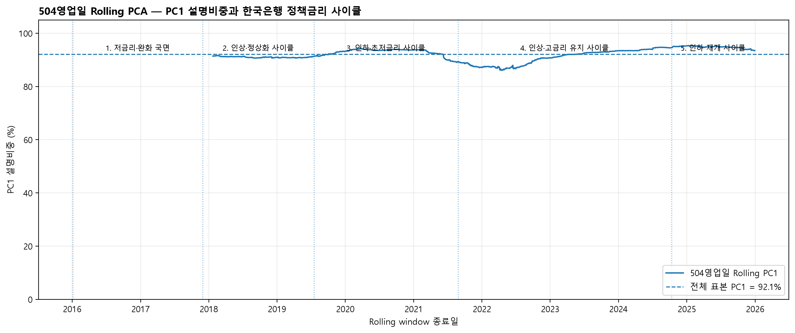

# STEP6. 수익률곡선 다요인 모형 분석 결과

**구성** B-1 금리요인 구축·핵심모형 · B-2 신용스프레드·검증·시각화
**노트북** `notebooks/06_yield_curve_exposure.ipynb`
**가설** H1 — 금리충격 원천에 따른 이질성

---

## Takeaway

- **λ=0.5의 Nelson–Siegel 사양에서는 Curvature 산업 간 차이가 관찰된다.** 산업 간 계수 동일성 검정은 F=3.580, **BH p=0.0047**이다. 다만 대체 λ와 나비 곡률에서는 유지되지 않는다.
- **의약품은 −0.00860**(BH p=0.0165), **운수장비는 +0.00621**(BH p=0.0252)로 **방향이 반대**다. 곡선 중기 구간이 볼록해질 때 서로 다르게 움직인다.
- **Level·Slope는 어느 산업에서도 유의하지 않다.** 산업 간 차이 검정도 통과하지 못한다(BH p 0.275·0.284).
- **Credit Spread를 추가하면 Curvature의 BH 유의성은 유지되지 않는다.** 직교화 뒤 계수가 돌아오는 것은 FWL의 기계적 결과이며, 효과 귀속이나 강건성을 식별하지 않는다.
- **H1의 Curvature 결과는 측정 방식에 민감한 조건부 결과다.** λ=0.5 사양의 신호를 일반적인 곡률 이질성으로 확대하지 않는다.

---

## 이 문서 읽는 법

| 구분 | 내용 | 지위 |
|---|---|---|
| **1부** | 3요인·4요인 모형 추정과 검정 | 본분석 |
| **2부** | 자료 구조 진단과 강건성 점검 | 보조 |
| **부록** | HAC 시차별 SE 참고표, BH 보정 단위(가설족 vs 전체) 비교 | 참고 |

> λ 기본값은 요인 분리 기준으로 정했다. 아래 "λ 선택" 절에 기준·근거·민감도를 밝혔다.

---

## 분석 개요

Baseline(STEP4·STEP5)에서 국고채 3년 기준 산업 간 금리베타 차이를 확인했다(BH p=0.00034).
이번 단계는 그 차이가 **곡선의 어느 부분에서 오는지**를 찾는 것이 목표다.

**회귀식**

```
산업수익률 = α + β_M·KOSPI
           + β_L·ΔLevel + β_S·ΔSlope + β_C·ΔCurvature
           + β_Credit·ΔCreditSpread + ε
```

| 항목 | 설정 |
|---|---|
| 요인 생성 | Nelson–Siegel, 공통 **λ = 0.5** (`config.NS_LAMBDA`) |
| Credit Spread | 회사채(3년, AA−) − 국고채 3년, 단위 %p |
| 표준오차 | HAC (Newey–West, maxlags=5) |
| 다중검정 | BH(FDR), 검정족 = 요인별 7개 산업 |
| 산업 간 차이 | 날짜 클러스터 표준오차 |
| 표본 | 2016-01-05 ~ 2025-12-30 일별, 산업별 N=2,451 |

### λ 선택 — 요인 분리 기준

λ는 **곡률이 어느 만기를 보는지**를 정한다. 곡률 loading이 최대가 되는 만기는 약 1.7932/λ이므로, **λ가 커질수록 곡률이 짧은 만기 쪽을 본다.**

| | **λ = 0.5 (기본값)** | λ = 0.8041 (비교값) |
|---|---|---|
| 선택 기준 | **산업별 요인 분리** | 곡선 재구성 오차 최소 |
| 곡률이 보는 만기 | 3.59년 | 2.23년 |
| 곡선 재구성 SSE | 2.028 | **1.158** |
| 최대 VIF | **7.17** | 9.46 |
| corr(Slope, Curvature) | **−0.173** | −0.559 |

> 이 표는 두 λ의 적합도·분리도를 비교한다. **어느 한쪽이 절대적으로 옳은 것은 아니며, 곡선 묘사와 요인 분리 사이의 절충이다.**

이 모형의 목적은 곡선을 정확히 묘사하는 것이 아니라 **각 요인에 대한 산업별 노출을 분리해 추정하는 것**이다. 요인이 서로 분리되지 않으면 "어느 요인 때문인가"에 답할 수 없다. 요인 간 다중공선성을 최소화하는 값은 0.52 부근이며, 소수점을 끌고 다니지 않도록 0.5로 고정했다.

**λ 선택에는 주가·검정통계량이 개입하지 않는다.** 국고채 금리만으로 결정된다. λ를 0.2~2.0에서 변화시킨 민감도 결과는 2-4절에 있다.

**사용 데이터**

| 구분 | 경로 |
|---|---|
| 산업·KOSPI 패널 | `data/processed/industry_rate_panel_daily.csv` |
| 국고채 1·3·5·10년 | `data/raw/rates/treasury_yield_curve_1_3_5_10y.csv` |
| 회사채 AA− 3년 | `data/raw/rates/corporate_bond_aa_minus_3y.csv` |

회사채와 국고채 원본의 날짜가 완전히 일치했다(양쪽 2,462일, 차집합 0). 결측 0일, 음(−) 스프레드 0일이다.

---

# 1부. 본분석

## 1-1. 곡률에서 산업별 차이가 나타난다

**3요인 모형 · Curvature 계수**

| 산업 | 계수 | HAC SE | t | p | **BH p** | |
|---|---|---|---|---|---|---|
| **의약품** | **−0.00860** | 0.00283 | −3.040 | 0.0024 | **0.0165** | 유의 |
| **운수장비** | **+0.00621** | 0.00231 | +2.687 | 0.0072 | **0.0252** | 유의 |
| 철강금속 | +0.00415 | 0.00288 | +1.441 | 0.1495 | 0.2616 | |
| 금융업 | +0.00241 | 0.00137 | +1.762 | 0.0781 | 0.1822 | |
| 전기전자 | +0.00144 | 0.00158 | +0.911 | 0.3623 | 0.5072 | |
| 건설업 | −0.00234 | 0.00306 | −0.765 | 0.4446 | 0.5187 | |
| 화학 | −0.00008 | 0.00170 | −0.047 | 0.9624 | 0.9624 | |

> 이 표는 곡률 계수를 산업별로 보여준다. **의약품과 운수장비의 부호가 반대**이며, 두 산업 모두 BH 보정 후에도 유의하다.

**Level·Slope는 유의하지 않다**

| 요인 | 최소 p (산업) | 최소 BH p |
|---|---|---|
| Level | 0.0294 (금융업) | 0.2057 |
| Slope | 0.1243 (건설업) | 0.6225 |

### 관찰 결과

- 3요인 모형에서 BH 보정 후 유의한 조합은 **2개**다. 둘 다 Curvature다.
- 의약품 −0.00860, 운수장비 +0.00621로 **부호가 반대**다.
- Level은 금융업에서 원 p=0.0294이나 BH 보정 후 0.2057로 비유의다.
- Slope는 7개 산업 전부 원 p 기준으로도 비유의다.

## 1-2. 산업 간 차이 검정 — 연구 질문 그 자체

개별 계수가 0인지가 아니라 **"산업마다 다른가"**를 직접 검정했다. 한 번에 검정하므로 다중검정 부담이 없다. 설정은 `src/models.py:cross_industry_Ftest()`를 따랐다(산업별 절편, 산업별 시장베타, 날짜 클러스터 SE).

| 모형 | 요인 | F | p | **BH p** | |
|---|---|---|---|---|---|
| 3년물 단일 (Baseline) | 3Y_Rate | 4.189 | 0.00034 | **0.00034** | 차이 있음 |
| 3요인 | Level | 1.472 | 0.1836 | 0.2755 | 차이 없음 |
| 3요인 | Slope | 1.236 | 0.2844 | 0.2844 | 차이 없음 |
| **3요인** | **Curvature** | **3.580** | **0.0016** | **0.0047** | **차이 있음** |
| 4요인 | Curvature | 2.124 | 0.0477 | 0.1909 | 보정 후 사라짐 |
| 4요인 | CreditSpread | 1.083 | 0.3699 | 0.3699 | 차이 없음 |

> 이 표는 산업 간 계수 동일성 검정 결과다. **곡률에서만 산업 간 차이가 유의**하며, Level·Slope는 통과하지 못한다.


### 관찰 결과

- Curvature 산업 간 차이는 F=3.580, BH p=0.0047로 유의하다.
- Level(0.2755)·Slope(0.2844)는 유의하지 않다.
- Credit Spread를 추가하면 Curvature의 BH p가 0.1909로 밀린다.

## 1-3. Credit Spread — 단독으로는 효과가 없다

| 산업 | 단독모형 β | 원 p | BH p |
|---|---|---|---|
| 의약품 | +0.11001 | 0.0078 | 0.0544 |
| 철강금속 | −0.06475 | 0.0242 | 0.0845 |
| 운수장비 | −0.05715 | 0.0569 | 0.1329 |
| 금융업 | −0.03531 | 0.0924 | 0.1617 |
| 화학 | +0.01843 | 0.3508 | 0.4912 |
| 건설업 | −0.00663 | 0.8427 | 0.9402 |
| 전기전자 | −0.00135 | 0.9402 | 0.9402 |

> 이 표는 Credit Spread 단독모형 결과다. 원 p 기준으로 2개 산업이 유의하나 **BH 보정 후에는 0개**다.

### 금융업 — 사전 예상 없음

신용스프레드 확대는 금융업에 상반된 두 경로로 작용한다. 차주 부실·대손 부담·조달비용 상승은 음(−), 대출 스프레드 확대와 위험보상 상승은 양(+)이다. 국내 금융업 지수는 은행·보험·증권이 혼재해 하위업종 반응이 상쇄될 수도 있다.

어느 쪽이 우세할지 이론으로 결정되지 않으므로 **방향을 가정하지 않았고, 결과를 본 뒤에도 가설을 바꾸지 않았다.** 단독 −0.0353(p=0.092)로 비유의다.

## 1-4. Credit Spread 추가에 대한 사양 민감도

Credit Spread를 함께 넣으면 곡률 계수가 줄어든다.

| 산업 | 3요인 | 4요인 | 계수 변화 |
|---|---|---|---|
| 의약품 | −0.00860 (BH 0.0165) | −0.00643 (BH 0.0901) | −25.2% |
| 운수장비 | +0.00621 (BH 0.0252) | +0.00536 (BH 0.0901) | −13.6% |

이것이 **실제 효과 감소인지, 겹친 부분의 배정 문제인지**를 구분해야 한다.
Credit Spread를 곡선 3요인에 직교화한 뒤 다시 넣었다.

| 산업 | 3요인 | 4요인 | **직교화 4요인** | 3요인과의 차이 |
|---|---|---|---|---|
| 의약품 | −0.008599 | −0.006435 | **−0.008599** (BH 0.0161) | <1.0e-17 |
| 운수장비 | +0.006207 | +0.005363 | **+0.006207** (BH 0.0240) | <1.0e-17 |
| 철강금속 | +0.004148 | +0.002900 | +0.004148 | <1.0e-17 |
| 금융업 | +0.002413 | +0.001543 | +0.002413 | <1.0e-17 |

> 이 표는 신용스프레드를 직교화했을 때의 곡률 계수를 보여준다.
> **3요인 모형과 최대 차이는 약 1e-17이다. 이는 직교화 순서에 따른 FWL의 기계적 결과다.**

### 관찰 결과

- 신용스프레드 변동 중 곡선 3요인으로 설명되는 부분은 **18.6%**다. 나머지 81.4%는 고유하다.
- 신용스프레드를 마지막에 직교화하면 곡률 계수가 3요인 값으로 **수치오차 범위에서 돌아온다**(FWL 정리).
- 직교화 후 의약품 BH 0.0161, 운수장비 BH 0.0240이지만, 이는 변수 순서를 정한 결과다.

**따라서 4요인 모형에서 곡률이 약해진 이유를 실제 효과 감소와 공유변동 배정 중 하나로 식별할 수 없다.**
직교화는 배정 규칙을 바꿀 뿐이며, 곡률 효과가 신용위험 통제 뒤에도 강건하다는 증거로 사용하지 않는다.

다만 공유분을 어느 쪽에 배정할지는 모형이 정해주지 않는다.
두 변수가 국고채 3년물을 함께 포함하기 때문이며, 이 부분은 자료로 분리할 수 없다.

## 1-5. 요인 간 상관과 VIF

| 변수 | VIF | Level | Slope | Curvature | CreditSpread |
|---|---|---|---|---|---|
| Level | 7.25 | 1.000 | −0.843 | −0.236 | −0.020 |
| Slope | 7.01 | −0.843 | 1.000 | −0.173 | 0.163 |
| **Curvature** | **2.45** | −0.236 | −0.173 | 1.000 | −0.411 |
| CreditSpread | 1.23 | −0.020 | 0.163 | −0.411 | 1.000 |
| KOSPI | 1.01 | 0.017 | −0.010 | −0.062 | 0.021 |

> 이 표는 요인 간 상관과 VIF를 보여준다. Curvature의 VIF는 2.45로 상대적으로 낮지만, 이 값만으로 경제적 효과의 분리나 유의성의 원인을 판정할 수 없다.

### 관찰 결과

- Curvature VIF는 2.45로 Level·Slope보다 낮다.
- Level(7.25)·Slope(7.01)는 서로 상관 −0.843으로 여전히 강하게 얽혀 있다.
- **VIF 약 7은 낮은 값이 아니다.** λ=0.8041의 9.46에서 **완화된 수준**이며, Level·Slope의 개별 해석에는 유보가 필요하다.
- Credit Spread의 VIF는 1.23이지만 Curvature와 상관은 −0.411이며, 경제적 효과의 독립성을 뜻하지 않는다.


---

# 2부. 자료 구조 진단과 강건성

## 2-1. 곡선 변동의 대부분은 평행이동이다

국고채 네 만기의 일별 변화를 주성분분석했다.

| 성분 | 설명비중 | 누적 | 1년 | 3년 | 5년 | 10년 |
|---|---|---|---|---|---|---|
| **PC1** | **92.09%** | 92.09% | +0.236 | +0.533 | +0.585 | +0.564 |
| PC2 | 4.79% | 96.88% | +0.458 | +0.536 | +0.010 | −0.709 |
| PC3 | 2.24% | 99.12% | +0.853 | −0.383 | −0.245 | +0.258 |

> 이 표는 곡선 변동의 구조를 보여준다. PC1이 네 만기 모두 같은 부호이므로 곡선 전체가 함께 움직인다.


### 관찰 결과

- PC1 하나가 변동의 92.09%를 설명한다.
- 곡률에 해당하는 성분은 2.24%에 불과하다.
- 3요인을 넣어도 조정 R²는 늘지 않는다(평균 **−0.0000269**, 7개 중 5개 감소).

### 작은 성분인데 왜 유의한가

곡률은 변동의 2.24%에 불과하므로 **설명력을 높이지 못한다.** 조정 R²가 그대로인 이유다.

그러나 이 작은 성분에 대한 **노출 방향이 산업마다 다르다.** 의약품 −, 운수장비 +로 갈린다. 평균적으로는 설명력이 없지만 **산업을 구분하는 데는 기여한다.**

이것이 단일 만기 모형과의 차이다. 3년물 하나로는 "산업마다 반응 크기가 다르다"까지만 알 수 있고, 곡률을 분리해야 **"방향이 반대인 산업이 있다"**가 보인다.

## 2-2. 동시검정 — 셋을 묶어도 같은 산업

$H_0$: Level·Slope·Curvature 계수가 모두 0

| 산업 | F | p | BH p | 개별 유의 |
|---|---|---|---|---|
| **의약품** | 4.737 | 0.0027 | **0.0188** | 1개 |
| **운수장비** | 3.592 | 0.0131 | **0.0460** | 1개 |
| 금융업 | 2.973 | 0.0306 | 0.0713 | 1개 |
| 나머지 3개 | 0.35~2.03 | 0.107~0.790 | — | 0개 |

> 이 표는 동시검정 결과다. **개별 계수 검정에서 유의했던 의약품·운수장비가 동시검정에서도 유의**하다.


## 2-3. HAC 시차를 바꿔도 결론은 그대로다

Newey–West 경험식은 T=2,451에서 약 8을 제시한다. 5·8·10·20으로 바꿔 확인했다.

| 산업 | lags 5 | 8 | 10 | 20 |
|---|---|---|---|---|
| **의약품** | 0.0027 | 0.0038 | 0.0051 | **0.0101** |
| **운수장비** | 0.0131 | 0.0125 | 0.0116 | **0.0075** |
| 금융업 | 0.0306 | 0.0373 | 0.0421 | 0.0515 |

> 이 표는 동시검정 p값의 시차별 변화다. 의약품·운수장비는 lags 20까지 유의하다.


### 관찰 결과

- 계수는 시차와 무관하게 동일하다. 표준오차만 달라진다.
- 판정이 뒤집힌 산업은 금융업 하나이며, 원래 경계에 있었다.
- 시차를 늘린다고 p가 항상 커지지는 않는다. 운수장비는 0.0131 → 0.0075로 작아졌다.

## 2-4. λ 민감도

λ를 0.2~2.0에서 변화시켜 결론이 흔들리는지 확인했다.

| λ | 곡률정점 | RMSE | 최대VIF | 개별 BH 유의 | 동시검정 유의 산업 |
|---|---|---|---|---|---|
| 0.3 | 5.98년 | 0.01929 | 13.68 | 4 | **3** |
| 0.4 | 4.48년 | 0.01668 | 8.37 | 3 | **3** |
| **0.5** | **3.59년** | **0.01435** | **7.17** | **2** | **3** |
| 0.6 | 2.99년 | 0.01248 | 7.54 | 0 | **3** |
| 0.8041 | 2.23년 | 0.01084 | 9.46 | 0 | **3** |
| 1.0~2.0 | 1.79~0.90년 | 0.012~0.020 | 12~89 | 0 | **3** |

> 이 표는 λ 전 구간의 결과다. **동시검정 유의 산업 수는 전 구간에서 3개로 동일**하며, 최대 VIF는 어느 λ에서도 7.17 이상이다.


개별 계수의 유의성은 λ에 따라 달라진다. 요인이 회전하며 공유 변동의 배정이 바뀌기 때문이다. 이는 Level·Slope의 개별 해석에 유보가 필요하다는 근거이기도 하다. **묶은 검정 결과는 λ와 무관하게 일정하다.**

## 2-5. 만기를 늘려도 나아지지 않는다

국고채 20년·30년을 추가해 만기를 6개로 늘려봤으나 요인 중첩은 해소되지 않았다.

- 곡선 재구성 오차 3.5배 증가
- 최대 VIF 9.46 → 18.36 (λ=0.8041 기준)
- 국고채 2년물은 2021-03-10부터만 존재해 전체 표본에 쓸 수 없다

만기 개수는 원인이 아니다.

## 2-6. 나비형 스프레드로 본 곡률 측정방식 민감도

Nelson–Siegel 곡률은 λ를 고정한 모형 기반 추정이다. λ 선택과 무관한지 확인하기 위해, 모형 없이 만기만으로 계산하는 나비형 스프레드(butterfly spread, `2×3년 − 1년 − 5년`)로 같은 비교를 반복했다.

| 요인 | NS·나비형 상관 |
|---|---|
| Level | 0.593 |
| Slope | −0.994 |
| **Curvature** | **0.833** |

> 이 표는 NS 요인과 만기 기반 대응 지표의 상관을 보여준다. Curvature는 0.833으로 두 측정 방식이 상당히 같은 변동을 포착한다.

| 산업 | NS 곡률β | NS p | 나비형 곡률β | 나비형 p | 부호 일치 |
|---|---|---|---|---|---|
| **의약품** | **−0.00860** | 0.0024 | **−0.04014** | **0.0048** | 일치 (둘 다 유의) |
| **운수장비** | **+0.00621** | 0.0072 | +0.01042 | 0.3088 | 일치 (나비형은 비유의) |
| 철강금속 | +0.00415 | 0.1495 | +0.01625 | 0.1808 | 일치 |
| 전기전자 | +0.00144 | 0.3623 | +0.00015 | 0.9829 | 일치 |
| 금융업 | +0.00241 | 0.0781 | −0.00078 | 0.9178 | 불일치 (둘 다 비유의) |
| 건설업 | −0.00234 | 0.4446 | +0.00279 | 0.8207 | 불일치 (둘 다 비유의) |
| 화학 | −0.00008 | 0.9624 | +0.00258 | 0.7644 | 불일치 (둘 다 비유의) |

> 이 표는 NS 곡률β와 만기 기반 나비형 스프레드β를 산업별로 비교한다. **의약품은 두 측정 방식 모두에서 유의하게 음(−)**이며, **운수장비는 부호는 일치하나 나비형에서는 유의성을 잃는다.** 부호가 갈리는 나머지 3개 산업은 NS 기준으로도 전부 비유의했던 산업이다.

### 관찰 결과

- 의약품의 음(−) 반응은 NS와 나비형 양쪽에서 관찰된다. 이는 개별 산업 수준의 제한적 신호다.
- 운수장비는 부호(+)는 같지만 나비형 기준에서 유의하지 않다. 어느 측정 방식이 더 정확하다고 결과만으로 판정하지 않는다.
- 부호가 다른 3개 산업은 두 측정 방식 모두에서 비유의하므로 별도의 경제적 의미를 부여하지 않는다.
- 나비 3요인 Curvature의 산업 간 동일성 검정은 F=1.706, raw p=0.1155, BH p=0.2794로 유의하지 않다. 따라서 전체 산업의 Curvature 이질성은 측정 방식에 민감하다.

## 2-7. Rolling PCA와 통화정책 국면 — 1차원성은 특정 국면에 국한되지 않는다

2-1절의 주성분분석(전체 기간 PC1 92.09%)이 특정 통화정책 국면에 쏠린 결과인지 확인하기 위해, 504영업일(약 2년) 창을 매일 옮겨가며 PC1 설명비중·Level–Slope 상관·최대 VIF를 다시 계산하고, 한국은행 기준금리 사이클 5개 구간(저금리·완화 → 인상·정상화 → 인하·초저금리 → 인상·고금리 유지 → 인하 재개)과 대조했다.

| 정책국면 | 기간 | 평균 PC1 비중 | 평균 \|Level–Slope 상관\| | 평균 최대 VIF | 3요인 평균 ΔAdj.R² | 개선 산업 수 |
|---|---|---|---|---|---|---|
| 저금리·완화 국면 | 2016-01~2017-11 | 91.10% | 0.930 | **15.18** | **+0.00064** | **3/7** |
| 인상·정상화 사이클 | 2017-11~2019-07 | 92.27% | 0.910 | 11.01 | −0.00034 | 3/7 |
| 인하·초저금리 사이클 | 2019-07~2021-08 | 90.18% | 0.886 | 12.58 | −0.00023 | 2/7 |
| 인상·고금리 유지 사이클 | 2021-08~2024-10 | 93.35% | 0.807 | 7.87 | −0.00048 | 1/7 |
| 인하 재개 사이클 | 2024-10~2025-12 | **93.92%** | 0.899 | 12.68 | −0.00172 | 2/7 |

> PC1 비중·Level–Slope 상관·최대 VIF는 각 국면에 포함된 504영업일 rolling window들의 평균값이다(`rolling_policy_cycle_summary.csv`). ΔAdj.R²·개선 산업 수는 그 국면 전체 구간을 한 번에 재추정한 값이다(`policy_cycle_curve_structure.csv`) — 두 계산 방식이 달라 국면 경계 부근에서는 완전히 같은 표본을 가리키지 않는다.

> 이 표는 통화정책 국면별로 다시 계산한 곡선 구조 지표를 보여준다. **PC1 비중은 모든 국면에서 89~94%로 일관되게 높다.**



### 관찰 결과

- 504영업일 Rolling PC1 설명비중은 전체 기간에서 86.08%~95.38% 범위였고, 국면 평균으로는 90.2%~93.9%로 항상 90% 안팎을 유지한다.
- PC1 비중이 가장 높았던 국면은 인하 재개 사이클(93.92%)이며, 가장 낮았던 인하·초저금리 사이클(90.18%)과도 차이는 3.7%p에 불과하다.
- Level–Slope 상관의 절댓값과 최대 VIF는 저금리·완화 국면(2016–2017)에서 가장 높다(|상관|=0.930, 최대 VIF=15.18).
- 인상·고금리 유지 사이클(2021–2024)은 다른 국면보다 뚜렷이 낮은 평균 최대 VIF(7.87)를 보이지만, 이 국면에서도 3요인 모형의 평균 조정 R² 증가폭은 오히려 음수(−0.00048)이고 개선된 산업 수도 5개 국면 중 가장 적은 1개다.

이는 2-1절의 결론(곡선 변동의 1차원성)이 특정 통화정책 사이클에 국한된 현상이 아니라 표본기간 전반에 반복되는 구조적 특징이며, 공선성이 상대적으로 낮아지는 국면에서도 3요인 모형의 설명력이 개선되지 않는다는 것을 확인한다(2-1절 "관찰 결과" 및 D-0-1 관찰 결과 참고).

---

## 해석

**H1의 Curvature 신호는 λ=0.5 사양에서만 관찰된 조건부 결과다.** 이 사양의 산업 간 차이는 F=3.580, BH p=0.0047이지만, 곡선 적합 기준의 대체 λ와 나비 곡률에서는 5% 수준을 충족하지 않는다.

**방향이 반대라는 점이 핵심이다.** 곡선 중기 구간이 볼록해질 때 의약품은 하락(−0.00860), 운수장비는 상승(+0.00621)한다. 단일 만기 모형으로는 반응 크기의 차이만 보이고, 이런 방향 차이는 드러나지 않는다. 요인을 분리한 값어치가 여기에 있다.

**부호 차이의 경제적 해석은 확인되지 않았다.** "방어주와 경기민감주의 차이"라는 설명이 가능한지 보기 위해 곡률 계수와 시장베타의 순위상관을 확인했으나 ρ=+0.143(p=0.760, n=7)으로 관련이 없다. 의약품(시장베타 0.789)이 음(−), 운수장비(1.006)가 양(+)이지만 전기전자(1.206)는 +0.0014로 거의 0이다. **부호 차이는 관찰 사실로만 보고하고 해석을 붙이지 않는다.**

**Level·Slope에서는 이질성이 확인되지 않는다.** 두 요인은 서로 상관 −0.843으로 강하게 얽혀 있어(VIF 7.25·7.01) 개별 기여를 분리하기 어렵다. Curvature의 VIF는 2.45로 상대적으로 낮지만, 이 진단은 Curvature 이질성의 원인이나 강건성을 입증하지 않는다.

**Credit Spread를 추가한 4요인 모형에서는 Curvature의 BH 유의성이 유지되지 않는다.** 신용스프레드 변동의 18.6%가 시장수익률·곡선요인과 통계적으로 대응하지만 공유분의 귀속은 자료로 정할 수 없다. 직교화 뒤 계수 보존은 FWL의 기계적 결과이므로 신용위험 통제 뒤 효과 유지의 증거가 아니다.

**곡선 변동의 92%는 평행이동이고 곡률은 2.24%에 불과하다.** 그래서 요인을 늘려도 설명력은 늘지 않는다(조정 R² 평균 −0.0000269). 그러나 작은 성분이라도 노출 방향이 산업마다 다르면 산업을 구분하는 데는 기여한다. 설명력과 이질성은 다른 문제다.

---

## 한계

- **Level·Slope 계수의 개별 해석은 유보가 필요하다.** VIF 7.25·7.01은 λ=0.8041의 9.46에서 완화된 수준이지만 낮은 값은 아니다.
- **곡률과 신용스프레드의 공유분(18.6%) 귀속은 자료로 정할 수 없다.** 어느 변수를 마지막에 직교화하느냐에 따라 그 변수의 계수가 보존되므로, 이를 효과 유지나 인과적 귀속의 증거로 쓰지 않는다.
- **λ 선택은 결과에 영향을 준다.** 기본값 0.5는 요인 분리 기준으로 정했고 주가·p값이 개입하지 않았으나, 곡선 적합도 기준(0.8041)에서는 곡률이 BH 보정 후 유의하지 않다. 두 값을 병렬로 보고한다.
- **유의한 산업은 7개 중 2개다.** 나머지 5개는 곡률 노출이 확인되지 않는다.
- **BH 보정 단위를 가설족(개별 표)이 아니라 노트북 전체 134개 검정으로 넓히면, 의약품·운수장비의 곡률 유의성도 사라진다**(부록 B). 본분석은 표준적 관행에 따라 가설족 단위 보정을 주 기준으로 삼지만, 이는 표본이 만들 수 있는 가장 보수적인 해석은 아니라는 뜻이다.
- 표본 전체를 한 기간으로 다뤘다. 신용위험 고조기에 국한된 반응은 국면 분리 분석의 몫이다.
- 모든 계수는 KOSPI를 통제한 뒤의 조건부 노출이며 인과관계가 아니다.

---

## 다음 단계

| | 내용 | 상태 |
|---|---|---|
| 1 | 곡률–신용스프레드 중첩 성격 점검 | **완료** — 18.6% 공유변동을 확인했지만 귀속은 식별되지 않음(1-4절) |
| 2 | 부호 차이의 경제적 해석 | **완료** — 시장베타와 무관(ρ=+0.143, p=0.760). 해석을 붙이지 않는다 |
| 3 | 만기 확대 | **완료** — 개선 없음(부록). 만기 개수는 원인이 아니다 |
| 4 | 모형 C 연계 | **완료** — `07_asymmetric_rate_response.ipynb`에서 곡률 상승·하락 비대칭 검정. 개별·동시검정 모두 비유의(동시검정 F(7)=0.7644, p=0.6173) — H1의 곡률 이질성은 방향 비대칭으로는 이어지지 않는다 |
| 5 | 회사채 다른 만기 수집 | 선택 — 5년 신용스프레드가 있으면 3년물 공유 문제를 우회할 수 있다 |
| 6 | Rolling PCA·정책국면 대조 | **완료** — 1차원성은 특정 국면에 국한되지 않음(2-7절) |
| 7 | 나비형 스프레드 대조 | **완료** — 의약품은 두 측정 방식 모두 유의(2-6절) |

---

# 부록

## 부록 A. HAC 시차별 표준오차 참고표

2-3절은 산업별 동시검정(joint F-test) p값의 HAC 시차(5·8·10·20) 민감도만 다뤘다. `appendix_06_se_by_table.csv`는 이를 **개별 계수** 수준까지 확장한 참고표다 — 3요인 모형(Level·Slope·Curvature × 7산업 × 4개 시차 = 84행)과 4요인 모형(Level·Slope·Curvature·CreditSpread × 7산업 × 4개 시차 = 112행)을 합쳐 총 196행이다.

> 이 표는 보고서 어디에도 등장하지 않는 조합을 포함해, 특정 계수의 유의성이 HAC 시차 선택에 따라 달라지는지 확인하려는 독자를 위한 원자료다. 결론을 바꾸는 새로운 발견은 없다 — 유의 판정은 계수별로 시차 전 구간(5~20)에서 대체로 안정적이며, 2-3절에서 이미 확인한 곡률(의약품·운수장비) 외에 시차에 따라 새로 유의해지거나 사라지는 계수는 없다.

## 부록 B. BH 보정 단위 비교 — 가설족 vs 노트북 전체

이 노트북은 본분석·탐색분석을 합쳐 21개 "가설족"(표 하나 안에서 7개 산업을 비교하는 단위 등)에 걸쳐 총 **134개**의 개별 유의성 검정을 수행한다. 본분석 전체(1부·2부)는 **가설족 단위**로 BH(FDR) 보정한다 — 예를 들어 3요인 Curvature 계수는 7개 산업끼리만 묶어 보정한다. 이는 계량경제 보고서의 표준적 관행이지만, 노트북 전체를 하나의 검정 묶음으로 보는 관점에서는 가장 보수적인 기준이 아니다.

`appendix_06_bh_families.csv`(21개 가설족)와 `appendix_06_bh_tests.csv`(134개 개별 검정)는 같은 134개 원 p값을 **전체 일괄(global) 기준**으로도 다시 보정해 두 기준을 나란히 비교한다.

| 기준 | 유의 판정 수 |
|---|---|
| 가설족 단위 (본분석 기준) | 125개 동일 유지 |
| 전체 일괄(134개 풀링) | **9개가 "유의→비유의"로 변경** |

> 이 표는 두 BH 보정 기준의 판정 차이를 보여준다. 판정이 바뀐 9개는 전부 "유의족 단위 기준" 판정만 있던 검정이며, 반대 방향(비유의→유의)으로 바뀐 검정은 없다.

**판정이 바뀐 9개 검정**은 전부 아래 두 산업의 곡률 관련 계수·검정과, 이를 재구성한 동치 명세(직교화·신용스프레드-직교화)에서 나온다.

| 검정 | 가설족 q | 전체 일괄 q |
|---|---|---|
| 3요인 곡률 — 의약품 | 0.0165 | **0.0598** |
| 3요인 곡률 — 운수장비 | 0.0252 | **0.1041** |
| 산업별 동시검정(3요인) — 의약품 | 0.0187 | **0.0598** |
| 산업별 동시검정(3요인) — 운수장비 | 0.0460 | **0.1600** |
| 산업 간 차이 검정 — Curvature | 0.0047 | **0.0598** |
| 직교화 곡률 — 의약품·운수장비 | 0.0165 / 0.0252 | **0.0598 / 0.1041** |
| 신용스프레드-직교화 곡률 — 의약품·운수장비 | 0.0161 / 0.0240 | **0.0598 / 0.1041** |

> 이 표는 판정이 바뀐 9개 검정의 두 q값을 나란히 보여준다. **의약품 계열 검정은 전체 일괄 q=0.0598로 5% 문턱을 근소하게 넘기고, 운수장비 계열은 더 큰 폭(0.10~0.16)으로 넘긴다.**

### 관찰 결과

- 가설족 단위(본분석 기준)로는 134개 중 125개(93.3%) 판정이 전체 일괄 기준과 동일하다.
- 판정이 바뀌는 9개는 모두 곡률·의약품·운수장비 관련 검정이며, 서로 다른 명세(3요인·동시검정·직교화·신용스프레드-직교화)에서 반복되는 같은 두 산업·같은 요인의 재확인이지, 독립적인 9개 발견이 아니다.
- 의약품의 곡률 유의성은 전체 일괄 q=0.0598로 5% 문턱에 근접해 있어, 보정 단위 선택에 결과가 민감하다.
- 운수장비는 가설족 단위에서도 상대적으로 약했던 결과(q=0.0252)이며, 전체 일괄 기준에서는 더 뚜렷하게 비유의로 바뀐다.

## 산출물

**Table** — `results/H1_yield_curve/tables/`

| 파일 | 내용 | 구분 |
|---|---|---|
| `maturity_beta_comparison.csv` | 3년·10년·장단기차 개별 회귀 | B-1 |
| `yield_curve_factor_betas.csv` | 3요인 계수·SE·p·CI | B-1 |
| `credit_spread_betas.csv` | 단독·확장모형 계수·BH p | B-2 |
| `factor_correlation_vif.csv` | 요인 상관행렬과 VIF | B-2 |
| `industry_difference_test.csv` | 산업 간 계수 동일성 검정 | B-2 |
| `lambda_selection_criteria.csv` | λ 선택 기준별 최적값 비교 | B-1 |
| `lambda_sensitivity.csv` | λ 0.2~2.0 민감도 | B-1 |
| `credit_curvature_overlap.csv` | 곡률–신용스프레드 중첩 진단 | B-2 |
| `curvature_market_beta_profile.csv` | 곡률 노출과 시장베타 순위상관 | B-2 |
| `exploratory_yield_pca.csv` | 주성분 설명비중·적재값 | 보조 |
| `exploratory_model_parsimony.csv` | 단일 만기 vs 3요인 조정 R² | 보조 |
| `exploratory_joint_ftest.csv` | 산업별 동시검정 | 보조 |
| `exploratory_two_factor_betas.csv` | 2요인 모형 | 보조 |
| `exploratory_orthogonalized_betas.csv` | 직교화 모형 | 보조 |
| `exploratory_hac_sensitivity.csv` | HAC 시차 5·8·10·20 (동시검정) | 보조 |
| `ns_vs_butterfly_factor_corr.csv` | NS·나비형 스프레드 요인 상관 | 2-6 |
| `curvature_ns_vs_butterfly_by_industry.csv` | NS vs 나비형 곡률β 산업별 비교 | 2-6 |
| `rolling_curve_structure.csv` | 504영업일 Rolling PC1·상관·VIF | 2-7 |
| `rolling_policy_cycle_summary.csv` | Rolling 지표의 정책국면별 평균 | 2-7 |
| `policy_cycle_curve_structure.csv` | 정책국면별 곡선구조 + 3요인 ΔAdj.R² | 2-7 |
| `appendix_06_se_by_table.csv` | HAC 시차별 개별 계수 SE 참고표 | 부록 A |
| `appendix_06_bh_families.csv` | BH 보정 가설족(21개) 요약 | 부록 B |
| `appendix_06_bh_tests.csv` | BH 보정 개별검정(134개) 전체 | 부록 B |

**Figure** — `results/H1_yield_curve/figures/`

- 01~11 (본분석·2부 강건성)
- `ns_vs_butterfly_curvature.png` (2-6) · `rolling_pc1_policy_cycles.png` (2-7)

**문서**

| 파일 | 내용 |
|---|---|
| `summary.md` | 이 문서 |

**데이터**

- `data/processed/industry_rate_panel_extended.csv`
