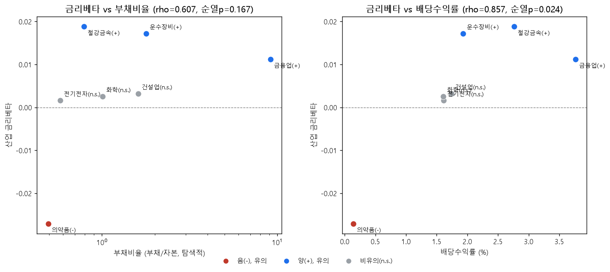
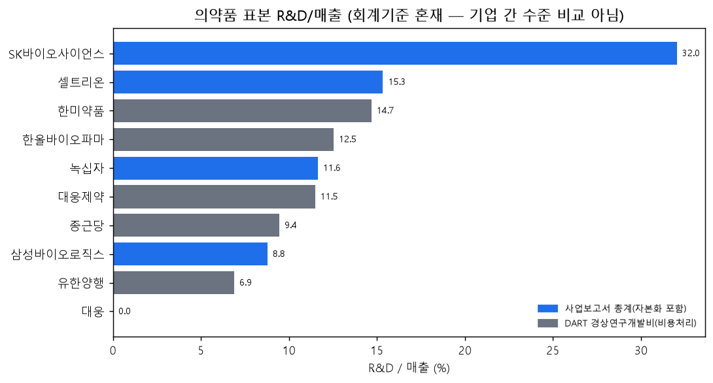

# STEP10. 산업 재무특성과 금리베타 탐색 (H3) 결과 요약

## Takeaway
- Baseline 공동검정(F=4.269, p=0.000264)은 산업 간 금리베타 차이를 확인하지만, BH 보정 후 유의한 쌍 6개(21쌍 중)는 전부 의약품이 포함된 쌍이다. 따라서 H3는 "7개 산업이 모두 다르다"가 아니라 "의약품 대 나머지 6개 산업"의 대비를 다룬다.
- 배당수익률 순위상관은 시가총액가중 기준 rho=0.8571(순열p=0.0238)로 n=7 임계값(0.7857)을 넘지만, 중앙값 기준(rho=0.5357)과 배당 결측처리 대안(rho=0.7857, 임계값과 정확히 일치)에서는 유의 판정이 경계선에 놓인다.
- 부채비율은 어떤 집계·기간 조합에서도 유의수준에 도달하지 않으며, 산업 1개(철강금속) 제외만으로 rho가 0.607→0.943으로 뒤집혀 결론 산출에 사용하지 않는다. 금융업 부채비율 자료는 DART 사업보고서 원문 재수집으로 43%→97% 복구했으나, 이 재수집은 순위상관 결과 자체를 바꾸지 않았다(자료 문제가 아니라 n=7 표본 크기의 구조적 한계).
- 의약품의 음(−) 금리베타·최저 배당수익률·최저 부채비율·두 자릿수 R&D 비중·최고 수준 시총집중도(HHI 0.357)는 데이터가 직접 보여주는 사실이나, 이를 "긴 현금흐름 듀레이션이 원인"이라는 인과관계로 해석하는 것은 검정되지 않았다. 10년물 베타(비유의)·NS Level(비유의) 등 만기별 노출 패턴은 단순 장기 듀레이션 설명과 완전히 정합하지 않는다.

## 분석 개요
Baseline(STEP4)에서 확인된 산업별 금리베타 차이, 특히 의약품에 집중된 차이가 산업 재무특성(부채비율·배당수익률) 순위와 어느 방향으로 정렬되는지를 7개 산업(n=7) 단위 Spearman 순위상관으로 탐색한다. 표본 크기가 작아 정확 순열검정과 순열분포 기반 임계값을 사용하며, 결론을 도출하는 확증적 분석이 아니라 Baseline 결과를 보조적으로 설명하는 탐색적 분석이다.

## 사용 데이터
- 입력 STEP: STEP4(Baseline_industry_beta), STEP6(H1_yield_curve), STEP9(firm_data_collection)
- 입력 파일: `data/raw/firm/firm_financials.csv`, `data/processed/firm_financials_recovered.csv`(금융업 부채비율 보완), `data/raw/firm/selected_top10.csv`, `data/processed/pharma_rnd_support.csv`, `results/Baseline_industry_beta/tables/rate_beta_by_industry_hac.csv`, `industry_beta_joint_test.csv`, `industry_beta_pairwise_tests.csv`, `results/H1_yield_curve/tables/maturity_beta_comparison.csv`, `yield_curve_factor_betas.csv`

## 핵심 결과

**표 1. 금리베타 vs 산업 재무특성 — Spearman 순위상관 (n=7, 정확 순열검정)**

| 관계 | n | rho | 순열 p | 임계값(0.05) | 유의 |
|---|---|---|---|---|---|
| 금리베타 vs 배당수익률 (7산업·시총가중) | 7 | 0.8571 | 0.0238 | 0.7857 | 유의 |
| 금리베타 vs 배당수익률 (7산업·중앙값) | 7 | 0.5357 | 0.2357 | 0.7857 | 비유의 |
| 금리베타 vs 부채비율 (7산업·시총가중, 탐색적) | 7 | 0.6071 | 0.1667 | 0.7857 | 비유의 |
| 금리베타 vs 부채비율 (금융제외 6산업, 탐색적) | 6 | 0.6571 | 0.1750 | 0.8857 | 비유의 |
| 금리베타 vs 부채비율 (7산업·중앙값, 탐색적) | 7 | 0.7500 | 0.0663 | 0.7857 | 비유의 |

> 이 표는 산업 단위(n=7) 재무특성과 금리베타의 순위 정렬을 보여준다. 배당수익률은 시총가중 기준에서만 유의하며, 부채비율은 모든 기준에서 비유의하다.

**표 2. 산업별 재무특성 집계 (시총가중/중앙값)**

| 산업 | 부채비율(시총가중) | 부채비율(중앙값) | 배당수익률(시총가중,%) | 배당수익률(중앙값,%) |
|---|---|---|---|---|
| 건설업 | 1.609 | 1.875 | 1.743 | 1.405 |
| 금융업 | 9.116 | 10.526 | 3.763 | 4.105 |
| 운수장비 | 1.784 | 2.073 | 1.931 | 0.469 |
| 의약품 | 0.493 | 0.628 | 0.139 | 0.360 |
| 전기전자 | 0.580 | 0.721 | 1.615 | 0.752 |
| 철강금속 | 0.791 | 0.913 | 2.763 | 1.830 |
| 화학 | 1.008 | 0.808 | 1.609 | 1.645 |

> 이 표는 7개 산업의 재무특성 대표값을 보여준다. 의약품은 부채비율·배당수익률 모두 7개 산업 중 최저다.

- Baseline 공동검정: F=4.269, df=(6, 17136), p=0.000264 (귀무가설 기각). 21개 쌍별 검정 중 BH 보정 후 유의한 6쌍은 전부 의약품 포함 쌍이며, 비의약품 15쌍은 모두 비유의(최소 BH p=0.100, 철강금속-화학). *이 F값은 `industry_beta_joint_test.csv`의 HAC 표준오차 기준이며, Baseline 보고서(STEP5)의 주 사양인 날짜 클러스터 표준오차 기준으로는 F=4.189·p=0.000338이다 — 두 사양 모두 5% 수준에서 기각되어 결론은 동일하다.*
- Leave-one-out(n=6): 배당수익률(시총가중) 상관은 의약품 제외 시에도 rho=0.7714로 부호·크기가 유지되나, 부채비율(시총가중) 상관은 철강금속 제외 시 rho=0.6071→0.9429로 유의 판정이 뒤집힌다.
- 배당 결측처리 대안(미공시연도를 결측 처리): rho=0.7857(p=0.0480)로 n=7 임계값과 정확히 일치 — 판정이 경계선.
- 금융업 부채비율 자료가용성: DART API의 XBRL 공백(8개사, 2016~2022년) 구간을 사업보고서 원문(document.xml)에서 직접 추출해 43/100(43%)→97/100(97%) 복구. 잔여 결측 3건(우리금융지주 2016~2018년)은 2019년 신설 법인이라는 구조적 사유. 복구 전후로 순위상관 결과는 동일(공통기간 재계산 rho=0.6071, 복구 전과 불변).
- 의약품 R&D/매출 비율 중앙값 11.6%(10개사 전체), 범위 0.01%~32.0%(회계기준 혼재로 기업 간 수준 비교에는 사용하지 않음).
- 의약품 시가총액 집중도 HHI 0.357(Top1 50.6%)로 7개 산업 중 1위이나 전기전자(HHI 0.346)와 사실상 같은 수준.
- 의약품 만기별·수익률곡선 요인 노출(H1 STEP6 결과): 국고 3년 β=−0.02707(p=0.0006, 유의), 국고 10년 β=−0.01598(p=0.070, 비유의), NS Level=−0.01382(p=0.383, 비유의), NS Curvature=−0.00860(p=0.0024, 유의).

## 해석

Baseline의 산업 간 차이는 의약품 대 나머지 6개 산업의 대비에 집중되어 있으며, 이 절의 순위상관은 그 대비를 재무특성 측면에서 보조적으로 재확인하는 탐색적 분석이다. 배당수익률이 낮은 산업일수록 금리베타가 낮은 방향의 정렬이 관측되고(시총가중 rho=0.857), 이는 낮은 현재 배당·높은 재투자가 미래 성장 기대 중심의 가치 구성과 모순되지 않으며 장기 현금흐름 논리와 정합적일 가능성을 시사하는 수준까지만 말할 수 있다. 다만 이 유의 판정은 결측 처리 규칙(대안 처리 시 임계값과 정확히 일치)과 집계 기준(중앙값 기준은 비유의)에 민감해 확정적 근거는 아니다.

부채비율은 자료 완전성이 크게 개선되었음에도(43%→97%) 순위상관 자체가 개선되지 않았고, 산업 1개 제외만으로 판정이 뒤집히는 n=7 표본 크기의 구조적 취약성을 그대로 갖고 있어 결론 산출에 사용하지 않고 탐색적 병기 변수로만 제시한다. 금융업의 부채비율은 예금·보험부채 중심이라 제조업의 차입 부담과 경제적 의미가 다르다는 점도 함께 고려해야 한다.

의약품의 음(−) 금리베타를 "긴 현금흐름 듀레이션"으로 설명하는 서사는, 배당수익률·부채비율·R&D·시총집중도가 데이터로 직접 확인되는 특성(A)과 그 특성이 성장주 듀레이션 논리와 모순되지 않는다는 정합성(B)까지만 뒷받침되며, 듀레이션이 음(−)베타의 원인이라는 인과관계(C)는 이 분석에서 검정되지 않았다. 특히 10년물 베타가 3년물보다 작고 비유의하며 NS Level 요인도 비유의하다는 점은 단순 장기 듀레이션 설명과 완전히 정합하지 않는 반대 방향 근거로 함께 기록한다.

## 핵심 표·그림

| 항목 | 값 | 비고 |
|---|---|---|
| 의약품 Baseline 금리베타 | −0.0271 | BH p=0.0038, 7산업 중 유일한 음(−) |
| 배당수익률-베타 순위상관(시총가중) | rho=0.857 | 순열p=0.024, n=7 임계값 0.786 초과 |
| 부채비율-베타 순위상관(시총가중) | rho=0.607 | 임계값 미달, 철강금속 제외 시 0.943로 반전 |
| 금융업 부채비율 자료 확보율 | 43%→97% | 사업보고서 원문 재수집, 순위상관 결과는 불변 |
| 의약품 R&D/매출 중앙값 | 11.6% | 10개사 전체, 회계기준 혼재 |
| 의약품 시총집중도 HHI | 0.357 | 7개 산업 중 1위(전기전자 0.346과 근접) |

> 이 표는 H3 분석의 핵심 수치를 요약한다. 배당수익률 정렬은 탐색적으로 정합적인 관측이며, 부채비율은 자료 개선에도 불구하고 결론 변수로 사용하지 않는다.

