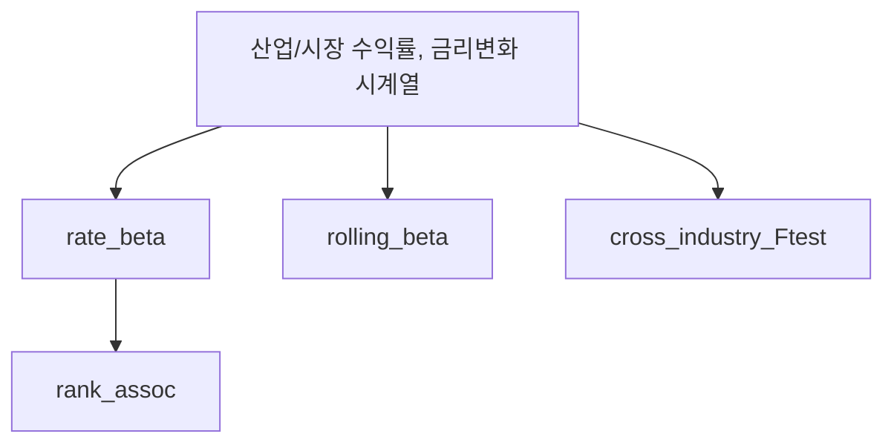

# src/

산업별 금리 베타 분석 코드.

## 폴더 소개

- **What**: 2지수 모형(시장+금리) 기반 산업별 금리 베타 추정 함수 모음
- **Why**: 산업마다 금리 변화에 대한 민감도가 다른지(Baseline), 그 차이가 산업 특성과 관련 있는지(H3) 검증하기 위함
- 핵심 기능
  1. HAC 표준오차 기반 금리 베타 추정
  2. 산업 간 베타 동일성 F-검정
  3. Rolling(시간변동) 베타 추정
  4. 베타-산업특성 순위상관 분석
  5. 합성 데이터로 파이프라인 동작 검증
  6. H3 KRX 구성종목·PBR·배당수익률·시가총액 재실행 가능 수집

## 사용 기술 스택

statsmodels(OLS, HAC), pandas, numpy, scipy.stats, requests

## 동작 원리

`rate_beta()`는 산업 수익률을 `[상수, 시장수익률, 금리변화]`에 회귀시키고 Newey-West(HAC) 표준오차로 금리 계수(β_r)를 추정한다. `cross_industry_Ftest()`는 산업 더미 × 금리변화 교차항을 만들어, 모든 산업의 교차항 계수가 같다는 귀무가설을 F-검정한다. `rolling_beta()`는 지정된 window(기본 504영업일)로 구간을 옮겨가며 `rate_beta()`를 반복 호출한다.

## 아키텍처



## 주요 결과 / 성과 지표

`__main__` 블록은 합성(가상) 데이터로 만든 동작 예시이며 실제 분석 결과가 아니다. 실데이터 연결 시 이 섹션에 실제 추정치를 기록한다.

## 디렉토리 구조

`src/`는 가설과 무관한 **재사용 라이브러리**다. 산업(Baseline·H1·H2)·기업(H3) 분석이 공통으로 import한다.

```
src/
├── README.md
├── __init__.py
├── krx_collector.py  # H3 KRX raw cache / 재시도 / 표준화 / validation
└── models.py         # rate_beta / cross_industry_Ftest / rolling_beta / rank_assoc
```

H3 시가총액 신규 다운로드는 프로젝트 `.env`의 `KRX_API_KEY`를 공식
`AUTH_KEY` 헤더로 사용한다. PBR·배당수익률·산업 구성종목은 공식 Open API
미제공 항목이므로 KRX 화면에서 내려받아 `config.KRX_MANUAL_DIR`에 둔다.
비공식 라이브러리는 사용하지 않는다. 요청별 원본 JSON은
`config.KRX_RAW_DIR`, 표준 CSV는 `config.KRX_INTERIM_DIR`에 저장되며 완료된
연도는 네트워크 요청 없이 재사용한다.

```powershell
python -m src.krx_collector --start-year 2016 --end-year 2025 --force
```

데이터 로딩·변수생성·시각화 코드가 노트북에서 반복되면 `io.py`, `features.py`, `viz.py`로 추출한다(지금은 노트북 내부에 있어 별도 모듈을 미리 만들지 않는다).
